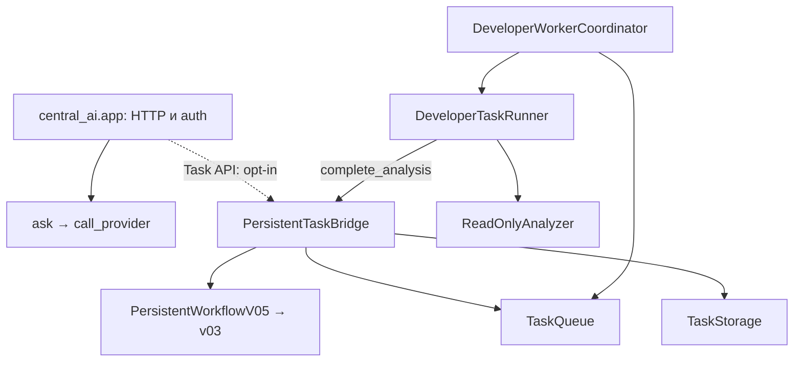

# Central AI / Market Engine — архитектура, решения и напредък

**Основен жив регистър. Обновен: 2026-11-04 (Europe/Sofia).** Датата в името е датата на създаване, а не последната актуализация. Текущ checkpoint: P0-REVIEW-01 / P0-AUDIT-01; предходните P0-RECON, IBKR/legacy guards и OPS-02 са запазени в историята. Този документ е отправната точка за текущата работа; [планът P0–P4](PROJECT_FOCUS_AND_COMPLETION_GATES_2026-11-02.md) определя реда. Старите датирани одити са доказателства за своите снимки, а не текущ статус.

## 1. Кой код и коя среда описваме

| Източник | Проверен checkpoint | Какво доказва |
|---|---|---|
| GitHub `main` | `d987387f45dbe25940502ea25542e7ad99673359` | Основният клон все още не съдържа целия стек |
| PR/source snapshot | PR #130, `a2aee7b81dc44e9ad0e566d215c38daa74dffee1` | Статичната PR/AST инвентаризация: 298 commits / 194 files спрямо main, 33/33 CI; остава датиран snapshot |
| Lease code delta | PR #130, `cf13d4c18038875e0b4fc07f0bbeb0348edcd504` | P0-LEASE-01: shared durable retry budget; **33/33 CI successful** |
| Financial quality delta | PR #130, `af585fd9a33585782ac2854cc59552ea00e16f67` | FIN-QUALITY-01: existing Financials/history/CLI owners; **33/33 CI successful** |
| Текущ code delta | PR #130, `4d5c3417872fdf27aa0d7a4b62bc62a46e8495c8` | Verifier result contract + durable intent/binding/outcome/quarantine in existing TaskStorage; **33/33 CI successful** |
| CI на Central AI образа | PR #128, `c38f12b9f7b1d6d61ab469c90c9ce2af8068ac1b` | 33/33 workflow изпълнения са успешни; build checkout `4a50c6da38f554fd10080d6c14eacfb31a830882` |
| CI на baseline корекцията | PR #129, същият `7fd9c85…` | [Run 41725530297](https://github.com/nsavchev/central-ai-market-engine/actions/runs/41725530297), job `126385986276`: **7 passed**, 2026-11-04. Останалите 32 изпълнения на този стар SHA запазват failure статуса. Следващият documentation checkpoint `3555fa5cc3199230d12ae56461bce25b90f811a8`, със същия Python код, вече е 33/33 green; този исторически резултат не се променя от CI на следващите commits |
| Cleanup CI | PR #130, `b67b288f56d310a8bfea8ad16667b641039a377f` | **33/33 успешни workflows**, проверени при възстановяването на работата на 2026-11-04; включват PostgreSQL numeric boundaries |
| Test/CI поправка | PR #130, `cfdce9591ebf3e4668f42a28402119c25c4ecf02` | OPS-02 + 12 пропуснати test files; **33/33 CI successful** |
| VPS доказателства | Извън публичния source snapshot | Подробните оперативни записи не се възпроизвеждат тук; изискват отделен защитен преглед |
| Публичност | GitHub metadata: `visibility=public`, 2026-11-04 | Публично repository; не означава публично изложен VPS API |
| Пълен архитектурен/VPS одит | [Issue #90](https://github.com/nsavchev/central-ai-market-engine/issues/90) е OPEN | Част от доказателствата са събрани; остава reconciliation преди нов модул/активация |

Този преглед е върху публичния source и GitHub CI. Той не приписва source SHA на целия production release и не замества отделния преглед на защитените оперативни доказателства.

## 2. Обхват и собственост

Двата продукта са Central AI (управление на разрешени AI задачи) и Market Engine (данни, анализ и paper симулация). Developer Agent е компонент на Central AI, а не трети паралелен AI manager. Първо вътрешен paper simulator; IBKR paper — след проверката му. Реални поръчки не са част от обхвата.

| Отговорност | Съществуващ собственик | Реално състояние / граница |
|---|---|---|
| Автентикация, `/ask`, `/providers`, task HTTP интерфейс | `central_ai/app.py` | API кодът е наличен; task endpoints са opt-in. Provider adapters не доказват конфигурирани акаунти или успешни външни заявки |
| Начално планиране на задача | `TaskBridge.submit` → `developer_agent/v3/orchestrator.py` | Planning adapter; паметта му не е постоянният регистър |
| Атомарно подаване и записване на анализ | `PersistentTaskBridge.submit/complete_analysis` | Използва съществуващите storage, queue и workflow; не създаваме втори bridge |
| Постоянни task записи и verification journal | `TaskStorage` в `central_ai/task_storage.py` | Един собственик на task payload и one-shot verification audit; няма нова table/queue/controller |
| Lease, heartbeat ownership и ограничени опити | `TaskQueue` + `HeartbeatWorker` | Една queue; не добавяме втори retry engine |
| Workflow преходи и възстановяване | `WorkflowController` v03 + `PersistentWorkflowV05` | v04 остава за съвместимост; старите модели не се изтриват без caller/recovery тестове |
| Избор на следваща задача | `DeveloperWorkerCoordinator.run_once` + `TaskFileTargets` | Координация, не генератор на код |
| Ограничен анализ на файл | `DeveloperTaskRunner.run_acquired_and_complete` → `ReadOnlyAnalyzer.analyze` | AST анализ без изпълнение на целевия Python файл; не е автономен repair loop |
| Подготовка на предложение и candidate | `prepare_review_pipeline`, `review_handoff`, `proposal_adapter`, `isolated_candidate`, `verifier_gate` | Opt-in pipeline с външно подадена препоръка; няма втора queue |
| Разрешена изолирана проверка | `prepare_and_verify` в `verified_review_pipeline.py` + `isolated_functional_verifier` | Отделни trusted tests и verify-only authorization; вече записва one-shot intent/binding/outcome и DB-scoped quarantine; не е автономен repair lifecycle |
| Стар trusted verifier | `developer_agent/v3/trusted_verifier*/` | Различни pinned trust baselines; не се сливат само заради сходни имена |
| Обобщение за release | `stage2_release_gate.py`, `release_preflight.py`, `release_build_policy.py` | Проверка/доклад, не merge/deploy разрешение |
| Market HTTP / данни | `app/main.py`, `app/db.py`, `app/ibkr.py`, `app/engine.py` | Изходният код е наличен; текущият VPS Market API не е обновяван с този стек |
| Source permissions / SEC | `app/sources.py`, `sec_edgar.py`, `sec_financials.py`, `fundamentals*.py` | Client/normalization и части от persistence; безопасен автоматичен SEC импорт не е завършен |
| Relative strength, macro, valuation, quality | `engine.py`, `scanner.py`, `macro.py`, `valuation.py`, `advanced_valuation.py`, `data_quality.py` | Съществуващи алгоритми; някои offline/explicit-input. Не са доказани live feeds, автоматични два дневни отчета или backtested предимство |
| Paper ledger, fencing, replay | `paper_atomic_service.py`, `paper_pg_fence.py`, `paper_idempotency.py` | Изолирани тестове; производствената DB миграция не е извършена |
| DB проверки по фаза | `paper_migration_baseline.py`, `paper_legacy_column_contract.py`, `paper_schema_readiness.py`, `paper_schema_constraints.py`, `paper_data_preflight.py` | Различни отговорности; baseline eligible не означава пълна еквивалентност |
| Миграции | `alembic_stage2/`, `migrations/`, `paper_populated_migration.py` | Текущите Stage 2 пътища остават disposable-only за DB `test` |

## 3. Как се свързват компонентите

Следната схема показва зависимостите в прегледания код. Task клонът в repository Compose е **изключен по подразбиране**. Схемата не е runtime telemetry.

Отделният review път е `prepare_review_pipeline` (handoff → proposal → verifier gate → frozen candidate), след това изрично разрешено `prepare_and_verify`. One-shot verification intent/binding/outcome вече се пазят в TaskStorage. Няма доказана автоматична връзка от HTTP заявка през provider-generated patch, независимо provisioned тестове/identity и ограничени повторни поправки до финален human review. Това е оставащата P1 работа, а не основание за нов AI manager.

Market Engine използва своя FastAPI app и PostgreSQL. Вътрешните paper операции са отделени от Central AI task SQLite. Source registry е контрол на достъпа до източници, а не разрешение за scraping. Следва да се запазят тези граници.

Пълните статични дефиниции, import връзки, blob SHA за модулите и dependency snapshot на отворените PR-и са в [генерираната инвентаризация](project-architecture-inventory.json). Съществуващият инструмент е `tools/audit_python_ownership.py`; не е добавян нов scanner. AST imports не са runtime call graph и не разрешават dynamic dispatch.

## 4. Граница между публичен source и оперативни доказателства

Този регистър публикува code ownership, API/function зависимости, публични Git commit/PR/CI връзки и acceptance условия. Подробни VPS конфигурации, deployment/database/image/volume метаданни, private backup сведения, ключове и техните runtime стойности не са част от настоящата публична промяна.

Source Compose описва opt-in tasks и отделни Central AI/Market API/DB отговорности. Това е конфигурационна политика от repository, не доказателство за текуща production конфигурация. Нито green CI, нито metadata от GitHub доказват сами по себе си runtime deployment или успешна provider връзка.

Операторските проверки са отделен evidence поток под #90. Публичният запис може да отбелязва, че доказателство е предоставено или че остава критерий, без да копира защитените оперативни данни. Този documentation checkpoint не изпълнява production операции и не затваря целия runtime/security одит.

## 5. Зависимости на PR-ите

При P0-RECON source snapshot-а има **128 отворени draft PR-а**. **87 heads** са в ancestry на кандидата, **41** остават извън него; всички base SHAs са ancestors на собствените си heads. Те не са 127 независими продукта. Машинният регистър съдържа всеки number, base/head branch и SHA. Git history е точният регистър на комитите; таблицата по-долу е управленското обобщение, а не измислена ретроспекция на всяка редакция.

| PR | Base → head | Предназначение | Статус на checkpoint-а |
|---|---|---|---|
| #126 | AI-26 → `df4a20f…` | AI-27 интеграционни pass/fail сценарии; injected verifier | Draft, unmerged; не доказва автономно поправяне |
| #127 | #126 → `b53a115…` | Замразен обхват и P0–P4 | Draft, unmerged |
| #128 | #127 → `c38f12b…` | P0 release/security и възпроизводим образ | Draft, unmerged; 33/33 CI; API-only образът е отделно прехвърлен |
| #129 | #128 → `7fd9c85…` | READ ONLY baseline и VPS DDL fixture | Draft, unmerged; 7 baseline теста passed, останалите CI още не са повторени |
| #130 — стабилизиране | #129 → `3555fa5…` → текущ cleanup candidate | Регистър, ME-API-01, DUP-07 и test coverage | Draft/unmerged; текущ code source `a2aee7b…` — **33/33 CI successful**; включва OPS-02 и пренесените липсващи защити от #15/#16 |

Не merge-ваме стека наведнъж и не пренасяме source от `main` върху VPS с blind pull/compose build. Първо се проверяват ancestry, дифовете, точният candidate и #90.

## 6. Регистър на дублиране и конкретни дефекти

[Подробна матрица DUP-01–07](AUD01_DUPLICATION_TRIAGE_AND_REFACTOR_GATES.md). В статичния snapshot има **89 модула** (34 app, 29 central_ai, 26 developer_agent), **276 function/class дефиниции**, **72 записани локални import връзки**, **16 групи с еднакви имена**, **0 parse failures**. Тези числа не са процент на готовност. Tests/migrations/tools са извън трите root-а; общо в tree има 168 Python файла.

- DUP-01: workflow модели — canonical v03 + persistent v05; caller/state compatibility преди консолидация.
- DUP-02: v04/v05 — legacy restore съвместимост, не автоматично изтриване.
- DUP-03: verifier поколения — pinned trust boundaries, не взаимозаменяеми по име.
- DUP-04: TaskBridge registry срещу TaskStorage — transient planning adapter срещу durable owner.
- DUP-05: schema preflights — различни фази, съставяне на отчет вместо изтриване.
- DUP-06: CI workflows — бъдеща консолидация само със запазени required checks/coverage.
- DUP-07: премахнати недостижимите parser/success branches и неизползваните imports/constants след `UNVERIFIED_REPORT_BLOCKED`. Същата функция и CLI остават безусловно блокирани; тестове проверяват отказ без четене и nonzero CLI exit дори за success-looking JSON.
- **ME-API-01 / HIGH — поправен в cleanup candidate:** различни import aliases `analyze_market` и `analyze_valuation` в `app/main.py` запазват алгоритмите в техните owners. Новите реални ASGI HTTP regression проверки възпроизведоха два HTTP 500 преди промяната; след нея проверяват relative strength, advanced DCF, 422 за липсващи общи сесии, 409 при нееднозначен symbol и 401 без token.
- **TEST-NUM-01 — поправено погрешно тестово очакване:** `NUMERIC(20,2)` допуска 18 integer + 2 fractional digits. Валидаторът `_fits` не е променян; тестът вече приема точните положителна/отрицателна граници и отхвърля реален overflow. Четири проверки срещу PostgreSQL CAST са добавени в съществуващия CI workflow.
- **TEST-ENV-01 — явни локални prerequisites:** пет PostgreSQL тестови модула пропускат теста само при липсващ URL в локална среда. CI продължава да изисква test URL; останалите DB-name/host проверки са запазени.
- **DUP review:** source scan на трите roots след поправката намери 0 conflicting top-level imports и 0 function-body tails след безусловни return/raise. Две групи с идентични top-level AST тела са verifier CLI wrappers с различни pinned owners/baselines; това не е основание да се изтрие trust boundary. Legacy persistence и task storage/lease слоевете също не са обявени за семантични дубликати.

## 7. Текущ работен регистър

| ID | Собственик / цел | Статус | Оставащо условие / следващо действие |
|---|---|---|---|
| DOC-01 | Този регистър + focus plan | Обновен в настоящата промяна | Поддържа се при всяка следваща задача и handoff |
| AUD-01 | Ownership/import инвентаризация | Статичен snapshot готов; runtime reconciliation PARTIAL | Ключовите callable bindings, compatibility callers и действителните deployed imports остават за проверка |
| AUD-02 / P0-RECON | PR зависимости/main drift | 128 PR-а класифицирани; 87 heads in ancestry / 41 outside; full review PARTIAL | 298 commits / 194 files; simulation conflicts при #20/#105; без merge/closure; disposition и лимити в секция 11 и JSON |
| P0-CI | Проверки на точния source | #130 `b67b288…`: 33/33 green; `cfdce959…`: **33/33 CI successful** | DONE за предходните sources; P0-LEASE-01 `cf13d4c…` и FIN-QUALITY-01 `af585fd…` също имат 33/33 CI; старите #129 failures остават исторически |
| SEC-01 | Secrets/publication | GitHub metadata потвърждава public | Публичността не доказва пълен security audit; подробни оперативни данни не се публикуват |
| OPS-API | Central AI API-only | Отделен операторски evidence поток | Публичният source регистър не разширява разрешенията към worker/task активация |
| DB-01 | Production schema | Evidence reconciliation PARTIAL | Пълни constraints/indexes/defaults/sequences/ownership/ACLs и всички writers |
| DB-02 | Backup/restore | Отделен защитен операторски запис | Повторни реалистични rehearsal-и и roles/ACL recovery преди миграция |
| DB-03 | Production baseline/migration | BLOCKED | DB-01/02, отделен reviewed production runbook, два restored-copy rehearsal-а и explicit authorization; не премахваме disposable guards |
| AI-01 / AI-02 | Един developer loop | Компоненти и отделни CI проверки; PARTIAL | Независим test/authorization източник, bounded repair lifecycle и безопасен runner; one-shot durable verification audit е добавен, но не е пълният repair loop |
| ME-API-01 / DUP-07 | Route binding и blocked legacy CLI | DONE за source `b67b288…`: 33/33 CI | Без нов runtime модул; runtime deployment остава отделна проверка |
| TEST-NUM-01 / TEST-ENV-01 | Числови граници и test prerequisites | DONE за source `b67b288…`: 33/33 CI, включително PostgreSQL | Локалните PostgreSQL skips не се отчитат като passed |
| CI-COV-01 | Изпълнение на всички съществуващи test files | 12 липсващи файла добавени към 5 съществуващи workflow команди в `cfdce959…` | Няма нерефериран `tests/test_*.py` файл; **33/33 CI successful** |
| DATA-01 | SEC безопасен автоматичен импорт | PARTIAL | `validate_source`, permissions, Financials provenance и quality преди PostgreSQL write |
| DATA-02 / MODEL-01 | Relative strength, macro, 3 сценария | PARTIAL | Проверени данни/fixtures, assumptions и два дневни отчета |
| OPS-PAPER | Вътрешен paper simulator, после IBKR paper | Изолирано покритие; production integration BLOCKED | DB/runbook/consumer acceptance, без реални поръчки |
| P0-IBKR-01 | `app.main.ingest` exception boundary | DONE в `a2aee7b…`: 33/33 CI | Пренесена липсващата защита от #15; generic 502 + correlation ID, без raw exception в response/log |
| P0-LEGACY-01 | `TradeRequest.validate_paper_fill` | DONE в `a2aee7b…`: 33/33 CI | Пренесена политика от #16: finite inputs, максимум 1 000 000, цена/такса 2 decimals, количество 6; default-deny gate запазен |
| FIN-QUALITY-01 | `Financials` → `validate_history_snapshot` → `check_snapshot` | Коригиран source `af585fd…`; **33/33 CI successful** | Explicit ones, permission-first import/read gate, legacy rejection without backfill, HTTP/CLI/PG regression evidence |
| P0-REVIEW-01 / P0-RESULT-01 | Existing authorization + verifier report contract | Source audit и contract correction в `4d5c341…`; **33/33 CI successful** | Exact pinned image/result/hash/status checks; HMAC host adapter остава отделна authority boundary; production identity unprovisioned |
| P0-AUDIT-01 | Existing `TaskStorage` verification journal | Intent/binding/outcome/quarantine записани атомарно; **33/33 CI successful** | One-shot per analyzed task; interrupted/quarantined state блокира verification в същата DB; без schema/retry engine |
| CLEANUP-PROOF-01 | Existing `isolated_functional_verifier` + journal resource intent | NEXT | Независимо доказателство за container absence след нормален/timeout/error изход и resources checkpoint преди dispatch; без automatic unquarantine |
| P0-LEASE-01 | `TaskQueue.acquire` / direct runner compatibility | Коригиран source `cf13d4c…`; **33/33 CI successful** | Общ durable budget; 30 targeted / 342 local passed, 43 PG skipped. Без нов owner, schema или retry engine |
| OPS-02 | Starlette/TestClient warning | DONE за `cfdce959…`; **33/33 CI successful** | `requirements-test.txt`: httpx2; тесен error warning policy в `pytest.ini`; runtime httpx и release lock са запазени |

**Единствена следваща активна задача:** CLEANUP-PROOF-01 — съществуващият functional verifier да доказва отсъствието на container-а след normal/timeout/error изход и да записва resource handles преди dispatch чрез trusted journal boundary. Acceptance: daemon failure/rm failure/early process exit не се обявяват за потвърден cleanup; crash преди финален report оставя достатъчен resource intent; без auto-unquarantine, prune или нов manager. P0-REVIEW-01 / P0-AUDIT-01 source `4d5c3417872fdf27aa0d7a4b62bc62a46e8495c8`: 100 targeted / 408 aggregate local passed, 44 PG skipped, **33/33 CI successful**. P0/#90, production identity и hard runner isolation остават OPEN; one-shot audit не е завършен автономен repair loop.

## 8. Решения и история на checkpoint-ите

| Дата | ID / промяна | Решение и доказателство | Резултат / оставащо |
|---|---|---|---|
| 2026-10-26 | AUD-01/02 | Създаден ownership/progress регистър; queue/bridge/coordinator/runner са различни слоеве | Запазваме собствениците; старият snapshot се пази в Git history |
| 2026-11-02 | SCOPE / PR #127 | Два продукта, P0–P4, без безкрайни AI-XX wrappers | Обхватът остава замразен |
| 2026-11-03 | P0 / PR #128 | Immutable source/image/lock и verify-only граници; 33/33 CI | Образът не разрешава developer-loop activation |
| 2026-11-03 | OPS-API / DB-01/02 | Оперативните evidence потоци са отделени от GitHub source/CI | Подробните deployment/database/backup сведения остават извън тази публична промяна |
| 2026-11-03 | DB-BASELINE / PR #129 | `inspect_legacy_baseline` enforcing READ ONLY/REPEATABLE READ; fixture + 4 PG regression сценария | CI първоначално не стартира заради изчерпания included Actions лимит |
| 2026-11-04 | SEC-01 / PUBLIC | Операторът промени repo към public; GitHub metadata потвърди | Публичността на repository не е разрешение за production промени |
| 2026-11-04 | P0-CI baseline retry | Run 41725530297, job 126385986276: 7 passed | Другите 32 проверки още предстоят |
| 2026-11-04 | DOC-01 / AUD-01 | Преизползван AST scanner: 89 модула/275 дефиниции; обновени съществуващите основни документи, README и contributor инструкции; добавен един JSON snapshot | Без нов Python модул, queue, scheduler, verifier, CI workflow или VPS промяна |
| 2026-11-04 | ME-API-01 / DUP-07 | След изричната cleanup задача PR #130 е разширен с отделен code commit; два aliases и премахнати недостижими report branches | Целеви набор 25 passed; новите HTTP тестове възпроизведоха 2 failures преди поправката |
| 2026-11-04 | TEST-NUM-01 / TEST-ENV-01 | Поправено погрешно numeric boundary очакване; локалните DB prerequisites са явни и CI остава задължителен | Aggregate local run: **295 passed, 43 skipped, 1 warning**; skipped PostgreSQL тестовете не са отчетени като passed |
| 2026-11-04 | CI-COV-01 | Новите route/numeric regressions са включени в два съществуващи workflow-а | Без нов Python runtime модул или нов CI workflow; Starlette warning остава OPS-02 |

| 2026-11-04 | HANDOFF / P0-CI | Възстановен контекст от прекъсналия чат и сверени GitHub файлове; `b67b288…` има 33/33 successful workflows | Предишното съобщение за 12 добавени test files не се потвърждава от този source; добавени са в `cfdce959…`, без ретроактивно приписване |
| 2026-11-04 | OPS-02 / CI-COV-01 | Owner: Starlette TestClient dependency resolution и съществуващите CI команди. Файлове: `requirements-test.txt`, `pytest.ini`, 26 workflow dependency lines, 5 test lists и README. PR #130 base: `7fd9c850f73edea70988b017d8dda2a4b70f3fc3`; source: `cfdce9591ebf3e4668f42a28402119c25c4ecf02` | Python 3.12: **300 passed, 43 skipped, 0 warnings**; `pip check` OK; negative missing-httpx2 import отхвърлен от warning policy; TestClient действително използва httpx2 2.16.0; runtime httpx 0.28.1 е запазен; **33/33 CI successful** |

| 2026-11-04 | P0-RECON / P0-IBKR-01 / P0-LEGACY-01 | All 128 PRs mapped; 87 ancestry heads / 41 outside; #20/#105 simulated conflicts. Missing #15/#16 safeguards ported into existing owners at `a2aee7b81dc44e9ad0e566d215c38daa74dffee1` | 11 red regressions before fix; 49 targeted / 325 aggregate passed, 43 PG skipped; 33/33 CI. FIN-QUALITY-01 and P0-LEASE-01 retained as explicit gaps; no merge/VPS action |

| 2026-11-04 | P0-LEASE-01 | Existing `TaskQueue.acquire` reserves the same three-attempt durable budget as `acquire_next` in one guarded UPDATE; source `cf13d4c18038875e0b4fc07f0bbeb0348edcd504`, PR #130, base `7fd9c850f73edea70988b017d8dda2a4b70f3fc3` | Before fix: 17 new regressions failed / original 1 passed. After: 30 targeted passed; 342 full local passed / 43 PG skipped / 0 warnings; **33/33 CI successful** |

| 2026-11-04 | FIN-QUALITY-01 | Existing permission/quality owners connected to persistence and history read; source `af585fd9a33585782ac2854cc59552ea00e16f67`, PR #130, base `7fd9c850f73edea70988b017d8dda2a4b70f3fc3` | 18 regressions failed / 14 passed before correction; 81 targeted passed / 1 PG skipped; 373 full local passed / 44 PG skipped / 0 warnings; **33/33 CI successful** |

| 2026-11-04 | PLAN-DAY-01 | Hourly target plan appended to existing focus plan; baseline source `af585fd…`, documentation `e4ed961…`, PR #130 / base `7fd9c850f73edea70988b017d8dda2a4b70f3fc3` | Planning only: P0-REVIEW-01 remains active; adaptive catch-up consumes optional acceptance/reserve, not safety gates. Actual work must carry exact SHA/tests/evidence and done/blocked status |

| 2026-11-04 | P0-REVIEW-01 / P0-RESULT-01 / P0-AUDIT-01 | Existing pipeline rejects inconsistent results and floating images; existing TaskStorage persists one-shot intent, exact authorization binding, outcome and quarantine. Source `4d5c3417872fdf27aa0d7a4b62bc62a46e8495c8`, PR #130/base `7fd9c850f73edea70988b017d8dda2a4b70f3fc3` | Contract pre-fix: 20 failed / 28 passed; journal pre-fix: 7 failed / 50 passed. Final: 100 targeted / 408 full local passed, 44 PG skipped, 0 warnings; **33/33 CI successful** |

| 2026-11-04 11:14 EET | CLEANUP-PROOF-01 | Existing verifier/journal independently checks daemon-observed absence and persists immutable handles before dispatch. Source `81d5fd6d1e6e86ed480effdf042bf3255fbbd852`, PR #130/base `7fd9c850f73edea70988b017d8dda2a4b70f3fc3` | 21 new regressions failed before fix; 132 targeted / 442 full local passed, 44 PG skipped, 0 warnings; **33/33 CI successful**, including actual Docker synthetic-authority pass/fail/durable outcome/replay and timeout cleanup |

| 2026-11-04 11:47 EET | P1-HARNESS-01 (bounded scope) | Source `ec435e74bb01d8342a48304ade17651fbf11c23a`, PR #130/base `7fd9c850f73edea70988b017d8dda2a4b70f3fc3`; fixed arithmetic-only policy + trusted harness completion + durable report fields | 15 regressions failed before fix; **166 targeted / 476 local passed, 44 PG skipped, 0 warnings**; **33/33 CI successful on runtime-equivalent candidate `3d7d7ca…`**; arbitrary Python/general autonomous loop remain unaccepted |

| 2026-11-04 12:07 EET | P1-RECOVERY-01 | Source `4159a43806e0b5020056c8fbfb9ad2e31bcc2228`, PR #130/base `7fd9c850f73edea70988b017d8dda2a4b70f3fc3`; existing AI-27/AI-22 process/Docker acceptance, no runtime changes | **479 local passed / 47 skipped** (44 PG + 3 Docker); **33/33 CI successful**, AI-22 6 passed / 0 skipped including real Docker; next P1-LOOP-GAP-01 |

Това е обобщение на проверимите checkpoint-и. То не твърди, че всяка стара промяна е била навреме описана отделно; точният пълен diff/история остава в Git и PR-ите.

## 9. Правило за всяка следваща промяна

1. Прочети този регистър, focus plan и съответния owner/caller/test код; използвай `rg` и съществуващия inventory tool.
2. Запиши TASK_ID, първоначална цел, съществуващ собственик/функции, защо е нужно изменение, файлове, dependencies и измеримо acceptance условие.
3. Предпочитай корекция на съществуващия собственик. Нов module/queue/controller/verifier изисква конкретен доказан пропуск и записано ownership решение.
4. След промяната запиши PR/base/head/source SHA, точните проверки и резултати, отделно GitHub/CI, операторски VPS evidence и непроверено. Update-вай този жив документ, не създавай нов датиран „основен“ регистър.
5. При всяко предаване на работата остави една следваща активна задача, blocker и acceptance условие. Отложените изисквания остават в таблицата.
6. Snapshot JSON се обновява при source/PR-inventory преглед, с точния анализиран commit. Не го наричай live runtime telemetry.
7. `approved=False`, `deployment_allowed=False`, no automatic merge/deploy, task API NO и paper-only остават граници. Green CI или наличен API ключ не ги отменя. Production промени изискват конкретно разрешен обхват.

## 10. OPS-02 възстановяване и проверка

[Официалният TestClient документ](https://starlette.dev/testclient/) описва httpx2 като предпочитан client. Възпроизведеното предупреждение идва от import fallback към httpx при липсващ httpx2. Добавен е тестов requirements файл, който включва съществуващия runtime requirements и httpx2 `>=2,<3`. 26 съществуващи CI test jobs използват този файл; няма нов workflow. `pytest.ini` превръща само конкретното fallback предупреждение в грешка. Няма warning suppression, runtime provider migration или промяна на pinned release образа.

CI-COV-01 mapping: `test_central_ai.py` → DUP-01; седем offline/data/valuation набора → Stage 1 real HTTP; executed_at contract → atomic idempotency; empty-fence contract → disposable migration; schema constraints/readiness → realistic schema. Всички съществуващи `tests/test_*.py` файлове вече са реферирани в CI командите; това не доказва всеки runtime път.

Локален aggregate: активиран изолиран venv, `python -m pytest -q`, **300 passed / 43 skipped / 0 warnings**. Skips са PostgreSQL prerequisites. `pip check`, AST parsing (275 definitions), warning negative check и CI file-reference check са успешни. GitHub/CI на точния source `cfdce9591ebf3e4668f42a28402119c25c4ecf02`: **33/33 success**. Примери: [Central AI contracts + API](https://github.com/nsavchev/central-ai-market-engine/actions/runs/41784611695), [Market HTTP + offline/data regressions](https://github.com/nsavchev/central-ai-market-engine/actions/runs/41784611969), [locked image](https://github.com/nsavchev/central-ai-market-engine/actions/runs/41784612036). Настоящата последваща промяна обновява само документацията; VPS не е проверяван или променян в тази сесия.

## 11. P0-RECON: конкретни source/PR решения

Източник `a2aee7b81dc44e9ad0e566d215c38daa74dffee1`, PR #130, base #129 `7fd9c850f73edea70988b017d8dda2a4b70f3fc3`. GitHub list: 128 open/draft PR-а; `git merge-base --is-ancestor` провери всеки head и base; 87 heads са включени по ancestry, 41 не са. `git merge-tree --write-tree` симулира присъединяването на 41-те странични heads към pre-fix `2b4fb01…`, без да променя branch refs или работния tree. Само #20/#105 върнаха конфликти. Чистата симулация не доказва съвместимост или сигурност. `git cherry` бе използван като допълнителен сигнал, не като доказателство за семантична еквивалентност. Пълният per-PR резултат е в `pr_reconciliation` на съществуващия JSON snapshot.

| PR / група | Проверено състояние | Решение / текущ собственик |
|---|---|---|
| 87 ancestry heads, включително #126–130 | Кодът е в текущата история; PR-ите още не са merged | Не се merge-ват повторно в кандидата; ancestry не е review на целия diff |
| #15 / P0-IBKR-01 | Raw exception leak все още присъстваше в `/ingest/ibkr` | Пренесена тясната корекция в `app/main.py`: generic `IBKR_INGEST_FAILED` + случаен correlation ID и същият ID в log без exception payload. Успешният import/update е проверен с disposable SQLite HTTP fixture; broker не е викан |
| #16 / P0-LEGACY-01 | Legacy `TradeRequest` допускаше положителна infinity, прекалена precision и липсваха старите caps | Пренесена съществуващата политика в същия model; не е добавен нов ledger. HTTP регресии проверяват 422 преди DB достъп. Legacy route остава default-deny и V2 е отделен Decimal owner |
| #14 / FIN-QUALITY-01 | `store_snapshot` още не вика `check_snapshot`; `Financials` не носи units/accounting metadata от този клон | На P0-RECON това беше реален gap. FIN-QUALITY-01 вече го покрива в `af585fd…` с по-тясна ones-only политика; виж секция 13. Самият стар PR не е merged/closed |
| #20 | add/add conflict в `app/paper_atomic_service.py`; старата сигнатура няма generation/connection, fence и текущия executed_at insert | HOLD за стария alternative. Запазва се текущият atomic/idempotency owner; старите writer semantics не се връщат. Самият стар PR не е променян/затварян |
| #105 | Конфликти в DUP-01 workflow и timer contract; добавя отделен Compose/service път | HOLD; текущият owner е #104/#106 с `deploy/ai08`, AI-06 Compose и cleanup на redundant periodic wrapper. Без втори timer или service |
| #2–12 | Странична A11 failure/incident/repair lineage/budget/staging линия, липсваща от текущия runtime | HOLD до mapping на persistence/state и callers спрямо настоящите queue/bridge/coordinator; не се внася втори retry/fix engine |
| #17–19, #21–32, #41–45 (без #20) | По-стари Decimal, fence, cutover, migration, preflight/readiness прототипи | HOLD за текущия release; reconcile със съществуващите Stage 2 owners/coverage преди отделен port. Не са автоматично обявени за семантични дубликати |
| #91–92 | Странични VPS collectors/inventory helpers | HOLD; преизползват се текущият read-only preflight и AST inventory tool; няма нов collector/workflow |
| #13, #33, #46 | Исторически audit/runbook линии | Контекст/доказателства; не са причина да се добавя runtime код или да се merge-ват масово |

Двете липсващи защити са възпроизведени преди поправката: **11 failures / 23 passed** в първия регресионен набор. След поправката и HTTP before-DB cases: **49 targeted passed**, full local **325 passed / 43 PostgreSQL-dependent skipped / 0 warnings**. На source `a2aee7b…` всички **33 CI workflows са успешни**, включително реалните PostgreSQL и Docker checks. Променени runtime/test owners: само `app/main.py`, `tests/test_engine.py`, `tests/test_stage2_legacy_write_gate.py`; нов Python модул или workflow не е добавян. Snapshot-ът вече е 89 source modules / 276 definitions / 72 imports / 0 parse failures.

### #90 evidence map и граници

| Условие | Налични доказателства | Остава непотвърдено / собственик |
|---|---|---|
| Source/PR/SHA и CI | Exact source/ancestry карта и 33/33 CI | Пълен line-by-line review на всичките 194 променени файла не е извършен |
| VPS API-only promotion | Операторският запис в [Market baseline evidence](MARKET_ENGINE_VPS_BASELINE_2026-11-03.md) описва приетия API-only scope и Task API NO | Не е нов live VPS read; не доказва целия current source или активен developer loop |
| Effective Compose/images/volumes/timer | Historical operator/preflight резултати и source Compose | Текущите deployed source/runtime imports и resolved permissions остават за защитен operator reconciliation |
| SQLite schema и queue compatibility | Source и disposable тестове | Актуална deployed schema/indices/counts; direct lease boundary е поправен в source `cf13d4c…`, без runtime rollout |
| PostgreSQL schema/writers | Операторски 5-table DDL fixture, read-only baseline + CI | Full constraints/index/default/sequence, ownership/ACL и всички writers; baseline eligible не е stamp approval |
| Restore | Операторски empty-data restore запис | Roles/ACL, full equivalence, populated data и два upgrade/rollback rehearsal-а преди production migration |
| Integrations/reviewer authority | Provider adapters, HMAC adapter и fail-closed source/tests | Реален независимо provisioned reviewer/test authority, persisted result, quarantine и external feed availability |

Публичният source регистър не съдържа защитени runtime конфигурации/идентификатори, ключове, raw logs или backup съдържание. Няма merge, branch closure, task/timer активация, VPS операция, migration или реална търговия. На P0-RECON checkpoint-а следваше P0-LEASE-01; той е затворен в source `cf13d4c…` (секция 12). Текущата задача FIN-QUALITY-01 и останалите #90 условия остават видими, без отклонение към нови P2 функции.

## 12. P0-LEASE-01: един бюджет за direct и scheduled leases

Owner/callers: `central_ai/task_queue.py:TaskQueue.acquire`; директните `DeveloperTaskRunner.run_check`, `run_analysis`, `run_and_complete` използват този метод. Scheduled `DeveloperWorkerCoordinator.run_once` използва съществуващото bounded `acquire_next`. Преди поправката direct acquisition не проверяваше/не увеличаваше persistent attempt count и позволяваше четвърти lease след три изтекли scheduled опита. Това е source-level compatibility gap, не доказателство за публичен HTTP exploit.

В `cf13d4c18038875e0b4fc07f0bbeb0348edcd504` само `acquire` е променен: един SQL UPDATE проверява `attempt_count < 3` и `retry_exhausted=0`, взема ownership/token и увеличава counter-а атомарно. Третото придобиване задава exhausted flag, но остава активен валиден lease; heartbeat/complete не харчат нов опит. След изтичане не се допуска нов direct или scheduled lease. Busy/denied заявки не харчат бюджет и не записват acquired audit event. Подписът, token-or-None return и fail-closed approval/deployment flags са запазени. Всеки успешен direct lease, включително за `run_check`, вече харчи един опит; не е въведен отделен direct budget.

Само още един съществуващ файл е променен: `tests/test_ai20_retry_consolidation.py`. Той вече е включен в DUP-01 CI; няма нов workflow. 17 нови регресионни случая възпроизведоха проблема преди поправката. Проверки след нея:

- **30 targeted passed**: AI-20 retries, crash recovery, developer integration и worker once/batch/supervisor.
- **342 aggregate passed / 43 PostgreSQL-dependent skipped / 0 warnings**; skipped cases не са passed.
- Direct/scheduled/mixed бюджети през повторно отваряне на DB; последен опит при direct/direct, direct/scheduled и scheduled/scheduled concurrent contenders с отделни SQLite връзки — един winner, един бюджетен запис.
- Реален child Python процес придобива втория lease след parent-а; след рестарт третият е последен. Thread race тестовете не се представят като пълен OS-process stress test.
- Третият lease подновява heartbeat и завършва; direct runner може да приключи анализа без промяна на source bytes. Всички три direct runner entrypoint-а отказват exhausted task преди анализ.
- Стар ownership token не може да heartbeat/complete след reacquisition; отказите по всеки от двата budget guards са fail-closed.
- Legacy SQLite queue без retry колони използва съществуващата constructor migration; direct acquisition не зависи от target registry. Няма нов schema migration или production backfill.

Исторически direct leases, които старият код не е броил, не се възстановяват като измислени counters. Промяната използва съществуващите записани counts; проверката на реалния SQLite state остава операторски #90 gate преди rollout. PR/AST JSON остава датираният snapshot на `a2aee7b…`; настоящият двуфайлов delta е описан тук и в Git, без повторна пълна PR инвентаризация.

GitHub/CI: source `cf13d4c…` — **33/33 CI successful**; [DUP-01 / retry and worker checks](https://github.com/nsavchev/central-ai-market-engine/actions/runs/41787379704). Последващият документационен commit променя само регистъра, плана, duplication triage и README. Няма VPS read/write, task activation, merge, deployment, промяна на producer/reviewer authority, generated-code execution или реална търговия.

## 13. FIN-QUALITY-01: explicit units и existing quality boundary

Code source `af585fd9a33585782ac2854cc59552ea00e16f67`. Променени са `app/fundamentals.py`, `app/fundamentals_history.py`, `app/history_cli.py`, synthetic `data/demo_financial_history.json` и трите съществуващи тестови файла `test_fundamentals.py`, `test_fundamentals_history.py`, `test_engine.py`. Няма нов runtime модул, DB колона/миграция, collector, workflow или SEC разрешение. Един helper `validate_history_snapshot` в съществуващия history owner преизползва `validate_source` и `check_snapshot`; така import/read/CLI не дублират quality policy.

PR #14 не е слят дословно: той приема scaled units, а текущите `calculate`/history формули не нормализират monetary totals спрямо actual shares/per-share prices. Затова Financials приема само explicit `ones` или unknown `None` за legacy parsing. Persistence и history metrics отхвърлят unknown units; няма implicit default/scale conversion. Calculation-only старите inputs могат да се парсват без units, но това не е import approval. `accounting_standard`, aware `retrieved_at` и `total_liabilities` се пазят в JSON. Optional accounting/retrieval metadata може да доведе до review warnings, не до измислено потвърждение.

`validate_source(..., automated=False)` остава първа проверка на persistence boundary. `sec_edgar`, Investolens и reference-only източници не могат да заобиколят manual permission gate. Missing units, future periods и balance mismatches се блокират преди lookup/add/flush. Невалиден update не променя стария payload; невалиден втори item отменя целия HTTP batch. Данните остават Decimal text, без float загуба на точност.

History read проверява quality отново, както и съответствието на payload identity с column symbol/date/type/currency/source преди metrics. Старите неизвестни/невалидни payloads се пазят непроменени; GET връща 422, докато операторът явно не потвърди metadata и не reimport-не през разрешения път. Коригираният reimport запазва същия snapshot ID. Няма backfill, изтриване или production операция. Warnings на existing policy остават видими в отчетите, а резултатът носи units=ones (или None за празен отчет).

CLI преизползва helper-а за целия batch преди demo DB initialization. Import и report са в една транзакция: отказан legacy report не оставя новоимпортирани rows и не създава/презаписва output report. Synthetic demo е маркиран ones; не е променяна реална база. Existing CLI create_all остава prototype convenience, не production migration authorization.

Локални проверки: **81 passed / 1 PostgreSQL prerequisite skipped** в целевите fundamentals/history/quality/SEC/HTTP tests; **373 aggregate passed / 44 PostgreSQL-dependent skipped / 0 warnings**. Първият смислен regression checkpoint преди корекцията беше **18 failed / 14 passed**. PostgreSQL regression е включен чрез съществуващия Stage 1 real-HTTP workflow, само за localhost DB `test`, в случаен собствен schema; проверява batch rollback, JSON metadata/Decimal text и отказ на invalid update. Това не е production schema rehearsal.

GitHub/CI за `af585fd…`: **33/33 CI successful**; [Stage 1 HTTP/history/real PostgreSQL regression](https://github.com/nsavchev/central-ai-market-engine/actions/runs/41788897103). Следващият commit обновява само документацията. Dated PR/AST JSON остава source `a2aee7b…`; настоящият delta и единствената нова helper функция са записани тук и в Git. Passing quality не доказва filing authenticity, GAAP/IFRS harmonization, point-in-time correctness или готов автоматичен SEC importer. Standalone valuation/ratio preview flows не са обявени за напълно quality-gated. Следва P0-REVIEW-01; общият P0/#90 и production activation остават OPEN/BLOCKED според доказателствата.

## 14. PLAN-DAY-01: днешен график и checkpoint правила

[Дневният план по часове](PROJECT_FOCUS_AND_COMPLETION_GATES_2026-11-02.md#day-plan--2026-11-04-europesofia) е целеви график за 2026-11-04, а не завършени milestones. Работи се по dependencies: при по-бърз напредък следващата допустима задача започва веднага; при закъснение core Central AI задачите използват optional Market Engine блока и резерва. Пазят се existing ownership и всички #90/trust/deployment граници.

При всеки реален работен checkpoint се записват: local/UTC timestamp, active task, exact source/PR head, completed checks/evidence, blocker, accepted outcome, next action и revised remaining estimate. Ако средата/connector/тестовете липсват или предходен writer още работи, това се записва като блокер; няма измислено изпълнение, паралелен writer върху същия branch или force update. Дневният план не създава runtime scheduler/manager и не активира production процеси.

PLAN-DAY-01 validation е документационна: relative links, непроменен dated JSON и diff whitespace; нов Python код или тестове не са добавяни. Git history съдържа точния последващ documentation SHA. P0-REVIEW-01 остава единствената активна техническа задача; самият график не затваря P0/P1/P2 или целия проект.

## 15. P0-REVIEW-01 / P0-AUDIT-01 checkpoint — 2026-11-04 10:18 Europe/Sofia

Source `4d5c3417872fdf27aa0d7a4b62bc62a46e8495c8`; runtime files са само `central_ai/verified_review_pipeline.py` и `central_ai/task_storage.py`, regressions са в existing `test_ai26_verified_review_pipeline.py` / `test_ai27_full_process.py`. Няма нов manager, queue, scheduler, module, database table/schema, verification retry engine или production activation. Existing AST tool потвърди 283 definitions / 74 local imports / 0 parse failures в текущия source; dated full PR/AST JSON остава snapshot `a2aee7b…`, а този delta е описан тук и в Git.

### Ownership и trust boundary

| Отговорност | Owner / проверено | Ограничение |
|---|---|---|
| Receipt authentication | Existing `make_hmac_review_authorizer`; exact tuple, nonce, TTL, configured shared key, false approval/deployment flags | Trusted host configuration/dependency; shared HMAC possession не е независима human/public-key signature. Real provider/keys не са provisioned |
| Candidate/test integrity | Existing prepared candidate и frozen functional verifier read/hash checks | Доверие в host/runner; не hard sandbox срещу hostile host/kernel/candidate behavior |
| Report consistency | `prepare_and_verify` now rejects floating image before preparation; passed/failed/timeout/cleanup status, strict bool/int, test hash echo и no authority escalation | Consistency checks не са криптографско доказателство, че всички semantic test assertions са изпълнени. Independent harness acceptance остава P1 условие |
| Durable intent/binding/outcome | Existing TaskStorage task JSON, guarded BEGIN IMMEDIATE transactions | One-shot verification, не нов task workflow controller. Task status остава analyzed; queue/workflow не се повишават до approved/deploy |
| Quarantine admission | Incomplete preparing/running или quarantined audit блокира new verification в същата database | Не е host-global quarantine за други DBs/direct low-level calls; trusted deployments трябва да използват този boundary |
| Runtime cleanup | Existing low-level verifier returns resource handles on uncertainty; wrapper вече ги пази в bounded report и journal | Normal completion още приема cleanup по producer status; independent container-absence proof и pre-dispatch resource persistence са CLEANUP-PROOF-01 |

### Реално поведение

`begin_verification` атомарно резервира one-shot nonce за analyzed task със завършена queue и false flags; паралелни заявки за същата или различни задачи в една DB имат един winner. Предишен verification record не се изтрива/замества и нов nonce не отключва replay. Unknown schema/phase или невалидни authority flags в audit record се отказват; това не е защита срещу host/DB owner с произволен write достъп. Preparing/running след прекъснат процес остава blocking до отделен operator reconciliation; няма автоматично изтичане или unsafe reset.

След проверен receipt exact task/candidate/test/image/nonce/verify_only binding и reviewer/authorization IDs се записват като running ПРЕДИ verifier dispatch. Само валиден source result може да се запише като completed; cleanup_unconfirmed, exception/cancel след възможен dispatch, invalid result или uncertainty при финалния audit write водят до quarantine/block, никога success. Ако и записът за грешка не е възможен, функцията връща грешка, а вече записаният intent остава blocking. Външни raw stdout/stderr, exception messages, MACs и ключове не се копират в journal. Локалните quarantine resource handles не се публикуват в GitHub evidence; няма auto-delete по тези handles.

Преди dispatch отказан receipt/preparation записва generic blocked stage/type и не вика verifier. Съществуващият еднократен artifact path и single verification intent изискват отделен нов reviewed task/reconciliation за следващ candidate; това не добавя автоматични repair опити и не отменя three-attempt analysis lease budget. Source bytes и approved/deployment flags остават непроменени в интеграционните fixtures.

### Проверки и граници

Преди result correction **20 нови случая failed / 28 passed**. Преди journal implementation **7 failed / 50 passed**. След двете промени: **100 targeted passed**, **408 full local passed / 44 PostgreSQL-dependent skipped / 0 warnings**. Targeted suite включва authorization/HMAC, real preparation pipeline integration с injected CI verifier, frozen low-level verifier fixtures, existing retry tests, abrupt child-process `os._exit(7)` с reopen на running intent, конкуренция, replay, cancellation, audit write failures и secret-message exclusion. Реален Docker не е изпълняван в локалния unit suite; отделните existing Docker workflows се оценяват отделно и не се представят като full authenticated repair-loop proof.

GitHub/CI за точния source: **33/33 CI successful**; [DUP-01 / authorization, durable journal and integration checks](https://github.com/nsavchev/central-ai-market-engine/actions/runs/41798327770). Следващият commit обновява само документацията. Следва independent cleanup/resource-intent proof, след него изолиран bounded lifecycle acceptance с реален verifier. Production reviewer provisioning, dedicated runner, current VPS/SQLite/schema/ACL/restore evidence, complete changed-file review и explicit rollout approval остават отделни #90 gates.

Day-plan disposition: source review и durable-audit части са придвижени преди целевите 11–12 часа; това не отбелязва целия developer loop или проекта за готов. Checkpoint е reviewable; следващият writer трябва да прочете current head и този запис преди mutation. Отчетите следват реалните доказателства, а не часовите етикети.

## 16. CLEANUP-PROOF-01 — 2026-11-04 11:14 Europe/Sofia

Source `81d5fd6d1e6e86ed480effdf042bf3255fbbd852`, parent/head before work `d8a5b0dc44b2d4e036333b3072c6bba61cbfd50c`, PR #130/base `7fd9c850f73edea70988b017d8dda2a4b70f3fc3`. Цел: normal return, timeout или успешен `docker rm` да не бъдат приемани за доказано почистване; resource handles да оцелеят при прекъсване преди Docker dispatch. Използвани са същите owners: `isolated_functional_verifier.run_functional_tests`, `verified_review_pipeline.prepare_and_verify` и `TaskStorage`; няма нов module, manager, queue, controller, scheduler, table или schema migration.

### Промяна и приемане

- Existing functional verifier прави bounded daemon query с exact generated container-name filter след normal pass/fail, timeout, launch OSError и cancellation. Само exit 0 + празен валиден name listing доказва absence в този момент. Ако контейнерът е наличен, след `rm -f` е нужна втора успешна absence query; rm nonzero, daemon/query failure, неочакван output или оставащ контейнер са cleanup uncertainty. Snapshot не се изтрива и положителният test result не се връща като success.
- Преди Docker command callback записва immutable `snapshot_directory` и `container_name` в existing task JSON при точния running nonce. Невъзможен запис спира dispatch. Pipeline вече изисква този запис и отказва quarantine report с различни handles; TaskStorage проверява същата връзка атомарно. One-shot/DB quarantine и false approval/deployment flags са запазени.
- Launch OSError при независимо потвърдена absence има отделен non-passing `execution_error` outcome, без измислен return code. Полето `executed_candidate=True` запазва legacy значението на възможен dispatch; не е доказателство, че candidate body е изпълнен. При uncertainty остава `cleanup_unconfirmed`. Cancellation не се превръща в success; uncatchable exit оставя durable running/resources за operator reconciliation. Няма auto-reset/unquarantine/prune.
- Променени файлове: трите existing runtime owners, `tests/test_ai18_isolated_functional_verifier.py`, `tests/test_ai26_verified_review_pipeline.py`, `tests/test_ai27_full_process.py` и existing `.github/workflows/ai19-real-functional-smoke.yml`. AI-19 добавя bounded actual Docker pass/fail/replay през реалните prepare/HMAC/journal owners с ephemeral **synthetic CI identity**, без реален reviewer key/provider. AI-22 запазва реалния timeout сценарий. Не е добавен workflow.

### Измерени проверки

Новият low-level regression set преди поправката: **21 failed / 15 deselected**. След промяната: **132 targeted passed** (functional verifier, retry, authorization/journal, full-process); full local Python 3.12 **442 passed / 44 PostgreSQL-dependent skipped / 0 warnings**. Покрити са 20 exit/cleanup комбинации, failure преди dispatch, immutable/mismatched/missing handles, actual child `os._exit(9)` след durable resource commit и преди Docker, cancellation и същинските existing pipeline/low-level/journal owners с injected Docker responses. Workflow Python blocks са parsed; интегрираният workflow plumbing е изпълнен локално с injected Docker, което НЕ е реален Docker acceptance. Local Docker executable липсва. AST delta: **287 definitions / 74 local imports / 0 parse failures**; full PR/AST JSON остава dated snapshot `a2aee7b…`.

Exact-source `81d5fd6d1e6e86ed480effdf042bf3255fbbd852`: **33/33 CI successful**. [AI-19 real Docker functional + bounded durable pipeline](https://github.com/nsavchev/central-ai-market-engine/actions/runs/41805778114) завърши успешно и в двата отделни steps; [AI-22 real timeout cleanup](https://github.com/nsavchev/central-ai-market-engine/actions/runs/41805778113) също е successful. Реалният synthetic-authority prepare → candidate → Docker pass/fail → durable outcome → replay rejection и container absence са потвърдени в CI, не локално и не на VPS. VPS/production не е четен или променян. Всички артефакти/authority в тестовете са отделени synthetic fixtures; няма production resource handles, keys или raw logs в публичния регистър.

### Оставащо и следващо действие

Тази проверка доказва daemon-observed absence при конкретна query, не hard sandbox, глобална изолация между други DBs/hosts или защита срещу hostile Docker daemon/host/kernel. Direct low-level calls остават explicit trusted-host API извън durable pipeline boundary. Независимото доказване, че semantic tests са завършили (включително candidate early `os._exit(0)`), не е решено с cleanup query/exit code. Synthetic HMAC не е production reviewer identity.

След exact-source CI: **P1-HARNESS-01**, преглед и failing regression за candidate early exit/test-completion boundary в съществуващия verifier/test harness, преди да се приеме общ автономен repair loop. Real bounded pass/fail CI scenario е ограничено acceptance evidence, а не пълно затваряне на P1/#90. Trusted test/reviewer provisioning, dedicated runner, current VPS/source/SQLite/ACL/restore/full-diff evidence и отделно rollout approval остават отворени. Day plan: durable persistence и cleanup source gates са придвижени преди целевия 12–13 блок; времето се използва за следващата зависимост, без пропускане на gates или нов P2 feature.

## 17. P1-HARNESS-01 — 2026-11-04 11:47 Europe/Sofia

Source `ec435e74bb01d8342a48304ade17651fbf11c23a`, parent `d77a8d7d62c0b295a8e89d07e1d8c1e496a30cb9`, PR #130/base `7fd9c850f73edea70988b017d8dda2a4b70f3fc3`. Existing owners: `isolated_functional_verifier.run_functional_tests`, `verified_review_pipeline.prepare_and_verify`, `TaskStorage.complete_verification`. Цел: exit 0 преди завършване на доверените тестове да не означава pass. Прегледът потвърди, че произволен candidate и тест в един Python процес могат да прекратят/подменят общото изпълнение; marker сам по себе си не решава това.

### Ownership решение и точно ограничен scope

В същия verifier е фиксирана policy **`bounded-arithmetic-v1`** само за първия allowlisted сценарий: 1–8 уникални undecorated функции, до 8 обикновени positional parameters, един return от ограничени numeric constants/parameter names и +, -, *, /, //, % или unary +/-; bounded AST size/depth. Отказват се imports, calls, attributes, decorators, defaults/annotations, класове, module statements, comprehensions, assignments, exponentiation и всеки непознат node. Validation използва точно hash-checked bytes преди snapshot/Docker. Unsupported candidate не се изпълнява и няма fallback към generic Python execution. Това е съзнателно стесняване на prototype execution API, не пълен sandbox или изпълнен общ developer loop. Proposal/candidate preparation остава source-only и може да подготвя по-общи артефакти; functional verifier няма да ги изпълни извън policy.

Самият existing verifier генерира малък trusted harness в същия frozen snapshot и го mount-ва read-only. Той изпълнява отделния hash-bound operator test и едва след нормалното му завършване издава уникален completion record, вързан към candidate/test hashes. `passed` изисква exit 0, точно един валиден record накрая и потвърдено cleanup. Stale/duplicate/truncated/missing record, `SystemExit(0)` или `os._exit(0)` не дават pass. Candidate policy изключва операциите, с които candidate би могъл да види/подправи record-а или да промени harness process; trusted operator tests, test inputs/assertion coverage, injected host verifier, Python image и host/daemon остават trusted boundary. Това НЕ е independent authentication срещу злонамерени tests/host или доказателство за качеството/покритието на assertions.

Existing report/journal изискват точната execution policy и strict `completion_confirmed` bool. Exit 0 без completion е non-passing **`completion_unconfirmed`**, с durable completed outcome при доказан cleanup, без approval/deployment promotion. Ако cleanup е unknown, quarantine има предимство и resource intent се запазва. Historical completed outcomes не се пренаписват; новите records имат допълнителни JSON fields без table/schema migration. Policy rejection след running intent остава conservative quarantine; няма автоматично reset/retry или нов budget.

### Проверки и evidence

Първите нови regressions преди поправката: **15 failed / 38 deselected**. Финално **166 targeted passed** и **476 full local passed / 44 PostgreSQL-dependent skipped / 0 warnings**. Покрити са unsupported/early-exit candidate code, accepted existing arithmetic fixtures, strict completion/policy binding, stale/duplicate/truncated output, durable completion uncertainty и реални отделни Python процеси с fixed synthetic tests за нормален край/assertion failure/SystemExit/os._exit. Тези local процеси не са Docker и не изпълняват произволен generated code. Existing AI-19 добавя real Docker early-test-exit и candidate policy rejection към pass/fail/replay lifecycle; syntax/plumbing е проверен локално с injected Docker responses. Към 11:49 EET branch ref е `ec435e7…`, но PR head/ref остава `d77a8d7…` и exact-source workflows липсват. Това е проверено и чрез remote branch/pull refs, а не само cached UI. Safe fast-forward Git push бе опитан, но HTTPS Git write authentication не е налична; не е търсен/публикуван credential и не е искано разширяване на правата. Разрешеният GitHub API успешно записва documentation checkpoint `13cee9e847f332c934b3a102e17db8fd4d8aa374` в същия branch с expected_sha, без force/rebase/merge. Към 11:53 EET PR snapshot още оставаше `d77a8d7…` и новите workflows липсваха. **В 11:54 EET синхронизацията се възстанови**: PR head `3d7d7caa7dc7869030875ef7cd31e75bc91b7453` съдържа новия код и documentation checkpoint-ите. За междинния implementation commit `ec435e7…` отделни workflows няма; проверяват се тези на current candidate `3d7d7ca…`. `git diff --exit-code ec435e7… 3d7d7ca… -- central_ai tests .github/workflows` потвърди идентични runtime/test/workflow bytes. [AI-19](https://github.com/nsavchev/central-ai-market-engine/actions/runs/41810571013) потвърди в реален Docker pass/fail, early test exit като completion_unconfirmed, candidate policy rejection и synthetic-authority durable completion/replay; [AI-22 timeout cleanup](https://github.com/nsavchev/central-ai-market-engine/actions/runs/41810570885) е отделният cleanup check. **Всички 33/33 workflows на точния candidate `3d7d7caa7dc7869030875ef7cd31e75bc91b7453` са successful**, потвърдено в 11:55 EET; това е source/CI evidence, не VPS acceptance. Временният PR sync blocker е resolved и exact-candidate CI gate е приет за ограничения arithmetic сценарий; следва P1-RECOVERY-01. Локалният tree е синхронизиран и не остава implementation writer. Actual Docker acceptance се записва едва след exact-source CI; local Docker executable липсва.

Променени са същите три runtime owners, същите три AI-18/26/27 test files и existing AI-19 workflow; няма нов Python module/workflow/queue/manager/controller/scheduler/database schema. AST delta: **291 definitions / 74 local imports / 0 parse failures**; full inventory JSON остава dated `a2aee7b…`. VPS/production не е проверяван или променян; approved/deployment_allowed остават false и Task API disabled.

### Следваща активна задача и отложено

**P1-RECOVERY-01**: в existing pipeline/AI-19/AI-22 да се свържат real isolated Docker timeout/cleanup uncertainty с durable quarantine, restart и отказ на ново изпълнение; без automatic unquarantine, live VPS или нов manager. Това следва bounded completion/source CI gate. Общата autonomous generation/revision функция и arbitrary Python verification остават незавършени; по-широк execution scope изисква отделно reviewed separation между trusted evaluator и candidate, а не отслабване на тази policy. Independent production reviewer/test provisioning, dedicated runner и #90 source/runtime/schema/ACL/restore/full-diff evidence остават отворени. Графикът използва преднината за следващите P1 dependencies; няма нов P2 feature или твърдение, че проектът е готов.

## 18. P1-RECOVERY-01 — 2026-11-04 12:07 Europe/Sofia

PR #130/base `7fd9c850f73edea70988b017d8dda2a4b70f3fc3`, starting head `3d7d7caa7dc7869030875ef7cd31e75bc91b7453`, source **`4159a43806e0b5020056c8fbfb9ad2e31bcc2228`**. Existing owners са непроменени: verified pipeline, functional verifier и TaskStorage. Променят се само existing `tests/test_ai27_full_process.py` и `.github/workflows/ai22-real-timeout-cleanup.yml`, плюс canonical documentation. Няма runtime correction, нов module/queue/manager/controller/scheduler/schema или automatic recovery path: задачата добавя липсващото integrated acceptance evidence върху наличните owners.

Existing AI-27 вече има една и съща тройка fixtures с injected или explicit opt-in Docker backend: timeout с потвърден cleanup; actual/synthetic container exit + injected unavailable daemon observation; abrupt verification-process `os._exit(17)` след container exit и преди cleanup/outcome. Synthetic verify-only receipt и bounded arithmetic policy са explicit; няма production reviewer provisioning. Child process изпълнява истинските prepare/authorization/verifier/journal owners; след неговия exit parent отваря отново DB и проверява durable outcome/resources, original source, false flags и admission. Same-task replay никога не стига до reauthorization/verifier; друга analyzed задача е позволена само при потвърден timeout cleanup и е блокирана при quarantined/running record. Crash няма измислен terminal outcome.

Existing AI-22 изпълнява същия test set с digest-pinned disposable Docker image. В quarantine сценария container run е реален, но daemon observation failure е **fault injection**, не реална Docker outage. Fixture-owner cleanup проверява exact generated container name, при нужда премахва само този test-owned container и проверява absence преди snapshot deletion. Проверява се, че този изричен test cleanup НЕ reset-ва durable audit phase. Няма automatic production unquarantine или broad Docker prune.

Local injected process cases минават; трите real-Docker cases са skipped локално поради липсващ explicit Docker image/executable. Local **169 targeted passed / 3 Docker skipped**; full **479 passed / 47 skipped / 0 warnings**: 44 PostgreSQL prerequisites и 3 explicit Docker cases. Exact-source [AI-22 run 41812180726](https://github.com/nsavchev/central-ai-market-engine/actions/runs/41812180726), job `126513881066`: **6 passed / 7 deselected / 0 skipped**, включително трите реални Docker сценария; job/всички steps successful. **33/33 workflows на exact source `4159a43806e0b5020056c8fbfb9ad2e31bcc2228` са successful**. Публикува се и останалият documentation-only CI confirmation за предишния bounded harness checkpoint, чиито runtime/test/workflow bytes вече са CI-verified на `3d7d7ca…`. Current runtime е непроменен; tests не доказват hardened runner, general generated-code execution, provider identity или текущ VPS deployment. Day plan: използва се преднината за 14–15 negative/recovery acceptance; резервът не се изразходва и P2 feature не се добавя.

След приемане на exact-candidate CI: **P1-LOOP-GAP-01**, mapping на remaining generation/revision/trusted-test/provider boundaries спрямо съществуващите owners, с един bounded repair/revision acceptance plan; не се добавя нов orchestrator/retry loop без доказан requirement gap. #90 current VPS/source/SQLite/schema/ACL/restore/full-diff и production authorization остават отворени.
