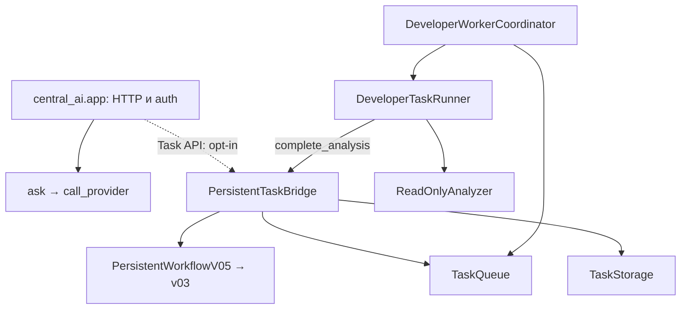

# Central AI / Market Engine — архитектура, решения и напредък

**Основен жив регистър. Обновен: 2026-11-05 (Europe/Sofia).** Датата в името е датата на създаване, а не последната актуализация. Текущ checkpoint: DB-IMAGE-ACCEPTANCE-01 (§27); предходните checkpoints са запазени в историята. Този документ е отправната точка за текущата работа; [планът P0–P4](PROJECT_FOCUS_AND_COMPLETION_GATES_2026-11-02.md) определя реда. Старите датирани одити са доказателства за своите снимки, а не текущ статус.

## 1. Кой код и коя среда описваме

| Източник | Проверен checkpoint | Какво доказва |
|---|---|---|
| GitHub `main` | `d987387f45dbe25940502ea25542e7ad99673359` | Основният клон все още не съдържа целия стек |
| PR/source snapshot | PR #130, `a2aee7b81dc44e9ad0e566d215c38daa74dffee1` | Статичната PR/AST инвентаризация: 298 commits / 194 files спрямо main, 33/33 CI; остава датиран snapshot |
| Lease code delta | PR #130, `cf13d4c18038875e0b4fc07f0bbeb0348edcd504` | P0-LEASE-01: shared durable retry budget; **33/33 CI successful** |
| Financial quality delta | PR #130, `af585fd9a33585782ac2854cc59552ea00e16f67` | FIN-QUALITY-01: existing Financials/history/CLI owners; **33/33 CI successful** |
| Текущ code delta | PR #130, `4d5c3417872fdf27aa0d7a4b62bc62a46e8495c8` | Verifier result contract + durable intent/binding/outcome/quarantine in existing TaskStorage; **33/33 CI successful** |
| CI на Central AI образа | PR #128, `c38f12b9f7b1d6d61ab469c90c9ce2af8068ac1b` | 33/33 workflow изпълнения са успешни; build checkout `4a50c6da38f554fd10080d6c14eacfb31a830882` |
| CI на baseline корекцията | PR #129, същият `7fd9c85…` | [Run 41725530297](https://github.com/nsavchev/central-ai-market-engine/actions/runs/41725530297), job `126385986276`: **7 passed**, 2026-11-04. Останалите 32 изпълнения на този стар SHA запазват failure статуса. Следващият documentation checkpoint `3555fa5cc3199230d12ae56461bce25b90f811a8`, със същия Python код, вече е 33/33 green; този исторически резултат не се променя от CI на следващите commits |
| Cleanup CI | PR #130, `b67b288f56d310a8bfea8ad16667b641039a377f` | **33/33 успешни workflows**, проверени при възстановяването на работата на 2026-11-04; включват PostgreSQL numeric boundaries |
| Test/CI поправка | PR #130, `cfdce9591ebf3e4668f42a28402119c25c4ecf02` | OPS-02 + 12 пропуснати test files; **33/33 CI successful** |
| VPS доказателства | Извън публичния source snapshot | Подробните оперативни записи не се възпроизвеждат тук; изискват отделен защитен преглед |
| Публичност | GitHub metadata: `visibility=public`, 2026-11-04 | Публично repository; не означава публично изложен VPS API |
| Пълен архитектурен/VPS одит | [Issue #90](https://github.com/nsavchev/central-ai-market-engine/issues/90) е OPEN | Част от доказателствата са събрани; остава reconciliation преди нов модул/активация |

Този преглед е върху публичния source и GitHub CI. Той не приписва source SHA на целия production release и не замества отделния преглед на защитените оперативни доказателства.

## 2. Обхват и собственост

Двата продукта са Central AI (управление на разрешени AI задачи) и Market Engine (данни, анализ и paper симулация). Developer Agent е компонент на Central AI, а не трети паралелен AI manager. Първо вътрешен paper simulator; IBKR paper — след проверката му. Реални поръчки не са част от обхвата.

| Отговорност | Съществуващ собственик | Реално състояние / граница |
|---|---|---|
| Автентикация, `/ask`, `/providers`, task HTTP интерфейс | `central_ai/app.py` | API кодът е наличен; task endpoints са opt-in. Provider adapters не доказват конфигурирани акаунти или успешни външни заявки |
| Начално планиране на задача | `TaskBridge.submit` → `developer_agent/v3/orchestrator.py` | Planning adapter; паметта му не е постоянният регистър |
| Атомарно подаване и записване на анализ | `PersistentTaskBridge.submit/complete_analysis` | Използва съществуващите storage, queue и workflow; не създаваме втори bridge |
| Постоянни task записи и verification journal | `TaskStorage` в `central_ai/task_storage.py` | Един собственик на task payload и one-shot verification audit; няма нова table/queue/controller |
| Lease, heartbeat ownership и ограничени опити | `TaskQueue` + `HeartbeatWorker` | Една queue; не добавяме втори retry engine |
| Workflow преходи и възстановяване | `WorkflowController` v03 + `PersistentWorkflowV05` | v04 остава за съвместимост; старите модели не се изтриват без caller/recovery тестове |
| Избор на следваща задача | `DeveloperWorkerCoordinator.run_once` + `TaskFileTargets` | Координация, не генератор на код |
| Ограничен анализ на файл | `DeveloperTaskRunner.run_acquired_and_complete` → `ReadOnlyAnalyzer.analyze` | AST анализ без изпълнение на целевия Python файл; не е автономен repair loop |
| Подготовка на предложение и candidate | `prepare_review_pipeline`, `review_handoff`, `proposal_adapter`, `isolated_candidate`, `verifier_gate` | Opt-in pipeline с външно подадена препоръка; няма втора queue |
| Разрешена изолирана проверка | `prepare_and_verify` в `verified_review_pipeline.py` + `isolated_functional_verifier` | Отделни trusted tests и verify-only authorization; вече записва one-shot intent/binding/outcome и DB-scoped quarantine; не е автономен repair lifecycle |
| Стар trusted verifier | `developer_agent/v3/trusted_verifier*/` | Различни pinned trust baselines; не се сливат само заради сходни имена |
| Обобщение за release | `stage2_release_gate.py`, `release_preflight.py`, `release_build_policy.py` | Проверка/доклад, не merge/deploy разрешение |
| Market HTTP / данни | `app/main.py`, `app/db.py`, `app/ibkr.py`, `app/engine.py` | Изходният код е наличен; текущият VPS Market API не е обновяван с този стек |
| Source permissions / SEC | `app/sources.py`, `sec_edgar.py`, `sec_financials.py`, `fundamentals*.py` | Client/normalization и части от persistence; безопасен автоматичен SEC импорт не е завършен |
| Relative strength, macro, valuation, quality | `engine.py`, `scanner.py`, `macro.py`, `valuation.py`, `advanced_valuation.py`, `data_quality.py` | Съществуващи алгоритми; някои offline/explicit-input. Не са доказани live feeds, автоматични два дневни отчета или backtested предимство |
| Paper ledger, fencing, replay | `paper_atomic_service.py`, `paper_pg_fence.py`, `paper_idempotency.py` | Изолирани тестове; производствената DB миграция не е извършена |
| DB проверки по фаза | `paper_migration_baseline.py`, `paper_legacy_column_contract.py`, `paper_schema_readiness.py`, `paper_schema_constraints.py`, `paper_data_preflight.py` | Различни отговорности; baseline eligible не означава пълна еквивалентност |
| Миграции | `alembic_stage2/`, `migrations/`, `paper_populated_migration.py` | Текущите Stage 2 пътища остават disposable-only за DB `test` |

## 3. Как се свързват компонентите

Следната схема показва зависимостите в прегледания код. Task клонът в repository Compose е **изключен по подразбиране**. Схемата не е runtime telemetry.

Отделният review път е `prepare_review_pipeline` (handoff → proposal → verifier gate → frozen candidate), след това изрично разрешено `prepare_and_verify`. One-shot verification intent/binding/outcome вече се пазят в TaskStorage. Няма доказана автоматична връзка от HTTP заявка през provider-generated patch, независимо provisioned тестове/identity и ограничени повторни поправки до финален human review. Това е оставащата P1 работа, а не основание за нов AI manager.

Market Engine използва своя FastAPI app и PostgreSQL. Вътрешните paper операции са отделени от Central AI task SQLite. Source registry е контрол на достъпа до източници, а не разрешение за scraping. Следва да се запазят тези граници.

Пълните статични дефиниции, import връзки, blob SHA за модулите и dependency snapshot на отворените PR-и са в [генерираната инвентаризация](project-architecture-inventory.json). Съществуващият инструмент е `tools/audit_python_ownership.py`; не е добавян нов scanner. AST imports не са runtime call graph и не разрешават dynamic dispatch.

## 4. Граница между публичен source и оперативни доказателства

Този регистър публикува code ownership, API/function зависимости, публични Git commit/PR/CI връзки и acceptance условия. Подробни VPS конфигурации, deployment/database/image/volume метаданни, private backup сведения, ключове и техните runtime стойности не са част от настоящата публична промяна.

Source Compose описва opt-in tasks и отделни Central AI/Market API/DB отговорности. Това е конфигурационна политика от repository, не доказателство за текуща production конфигурация. Нито green CI, нито metadata от GitHub доказват сами по себе си runtime deployment или успешна provider връзка.

Операторските проверки са отделен evidence поток под #90. Публичният запис може да отбелязва, че доказателство е предоставено или че остава критерий, без да копира защитените оперативни данни. Този documentation checkpoint не изпълнява production операции и не затваря целия runtime/security одит.

## 5. Зависимости на PR-ите

При P0-RECON source snapshot-а има **128 отворени draft PR-а**. **87 heads** са в ancestry на кандидата, **41** остават извън него; всички base SHAs са ancestors на собствените си heads. Те не са 127 независими продукта. Машинният регистър съдържа всеки number, base/head branch и SHA. Git history е точният регистър на комитите; таблицата по-долу е управленското обобщение, а не измислена ретроспекция на всяка редакция.

| PR | Base → head | Предназначение | Статус на checkpoint-а |
|---|---|---|---|
| #126 | AI-26 → `df4a20f…` | AI-27 интеграционни pass/fail сценарии; injected verifier | Draft, unmerged; не доказва автономно поправяне |
| #127 | #126 → `b53a115…` | Замразен обхват и P0–P4 | Draft, unmerged |
| #128 | #127 → `c38f12b…` | P0 release/security и възпроизводим образ | Draft, unmerged; 33/33 CI; API-only образът е отделно прехвърлен |
| #129 | #128 → `7fd9c85…` | READ ONLY baseline и VPS DDL fixture | Draft, unmerged; 7 baseline теста passed, останалите CI още не са повторени |
| #130 — стабилизиране | #129 → `3555fa5…` → текущ cleanup candidate | Регистър, ME-API-01, DUP-07 и test coverage | Draft/unmerged; текущ code source `a2aee7b…` — **33/33 CI successful**; включва OPS-02 и пренесените липсващи защити от #15/#16 |

Не merge-ваме стека наведнъж и не пренасяме source от `main` върху VPS с blind pull/compose build. Първо се проверяват ancestry, дифовете, точният candidate и #90.

## 6. Регистър на дублиране и конкретни дефекти

[Подробна матрица DUP-01–07](AUD01_DUPLICATION_TRIAGE_AND_REFACTOR_GATES.md). В статичния snapshot има **89 модула** (34 app, 29 central_ai, 26 developer_agent), **276 function/class дефиниции**, **72 записани локални import връзки**, **16 групи с еднакви имена**, **0 parse failures**. Тези числа не са процент на готовност. Tests/migrations/tools са извън трите root-а; общо в tree има 168 Python файла.

- DUP-01: workflow модели — canonical v03 + persistent v05; caller/state compatibility преди консолидация.
- DUP-02: v04/v05 — legacy restore съвместимост, не автоматично изтриване.
- DUP-03: verifier поколения — pinned trust boundaries, не взаимозаменяеми по име.
- DUP-04: TaskBridge registry срещу TaskStorage — transient planning adapter срещу durable owner.
- DUP-05: schema preflights — различни фази, съставяне на отчет вместо изтриване.
- DUP-06: CI workflows — бъдеща консолидация само със запазени required checks/coverage.
- DUP-07: премахнати недостижимите parser/success branches и неизползваните imports/constants след `UNVERIFIED_REPORT_BLOCKED`. Същата функция и CLI остават безусловно блокирани; тестове проверяват отказ без четене и nonzero CLI exit дори за success-looking JSON.
- **ME-API-01 / HIGH — поправен в cleanup candidate:** различни import aliases `analyze_market` и `analyze_valuation` в `app/main.py` запазват алгоритмите в техните owners. Новите реални ASGI HTTP regression проверки възпроизведоха два HTTP 500 преди промяната; след нея проверяват relative strength, advanced DCF, 422 за липсващи общи сесии, 409 при нееднозначен symbol и 401 без token.
- **TEST-NUM-01 — поправено погрешно тестово очакване:** `NUMERIC(20,2)` допуска 18 integer + 2 fractional digits. Валидаторът `_fits` не е променян; тестът вече приема точните положителна/отрицателна граници и отхвърля реален overflow. Четири проверки срещу PostgreSQL CAST са добавени в съществуващия CI workflow.
- **TEST-ENV-01 — явни локални prerequisites:** пет PostgreSQL тестови модула пропускат теста само при липсващ URL в локална среда. CI продължава да изисква test URL; останалите DB-name/host проверки са запазени.
- **DUP review:** source scan на трите roots след поправката намери 0 conflicting top-level imports и 0 function-body tails след безусловни return/raise. Две групи с идентични top-level AST тела са verifier CLI wrappers с различни pinned owners/baselines; това не е основание да се изтрие trust boundary. Legacy persistence и task storage/lease слоевете също не са обявени за семантични дубликати.

## 7. Текущ работен регистър

| ID | Собственик / цел | Статус | Оставащо условие / следващо действие |
|---|---|---|---|
| DOC-01 | Този регистър + focus plan | Обновен в настоящата промяна | Поддържа се при всяка следваща задача и handoff |
| AUD-01 | Ownership/import инвентаризация | Статичен snapshot готов; runtime reconciliation PARTIAL | Ключовите callable bindings, compatibility callers и действителните deployed imports остават за проверка |
| AUD-02 / P0-RECON | PR зависимости/main drift | 128 PR-а класифицирани; 87 heads in ancestry / 41 outside; full review PARTIAL | 298 commits / 194 files; simulation conflicts при #20/#105; без merge/closure; disposition и лимити в секция 11 и JSON |
| P0-CI | Проверки на точния source | #130 `b67b288…`: 33/33 green; `cfdce959…`: **33/33 CI successful** | DONE за предходните sources; P0-LEASE-01 `cf13d4c…` и FIN-QUALITY-01 `af585fd…` също имат 33/33 CI; старите #129 failures остават исторически |
| SEC-01 | Secrets/publication | GitHub metadata потвърждава public | Публичността не доказва пълен security audit; подробни оперативни данни не се публикуват |
| OPS-API | Central AI API-only | Отделен операторски evidence поток | Публичният source регистър не разширява разрешенията към worker/task активация |
| DB-01 | Production schema | Evidence reconciliation PARTIAL | Пълни constraints/indexes/defaults/sequences/ownership/ACLs и всички writers |
| DB-02 | Backup/restore | Отделен защитен операторски запис | Повторни реалистични rehearsal-и и roles/ACL recovery преди миграция |
| DB-03 | Production baseline/migration | BLOCKED | DB-01/02, отделен reviewed production runbook, два restored-copy rehearsal-а и explicit authorization; не премахваме disposable guards |
| AI-01 / AI-02 | Един developer loop | Компоненти и отделни CI проверки; PARTIAL | Независим test/authorization източник, bounded repair lifecycle и безопасен runner; one-shot durable verification audit е добавен, но не е пълният repair loop |
| ME-API-01 / DUP-07 | Route binding и blocked legacy CLI | DONE за source `b67b288…`: 33/33 CI | Без нов runtime модул; runtime deployment остава отделна проверка |
| TEST-NUM-01 / TEST-ENV-01 | Числови граници и test prerequisites | DONE за source `b67b288…`: 33/33 CI, включително PostgreSQL | Локалните PostgreSQL skips не се отчитат като passed |
| CI-COV-01 | Изпълнение на всички съществуващи test files | 12 липсващи файла добавени към 5 съществуващи workflow команди в `cfdce959…` | Няма нерефериран `tests/test_*.py` файл; **33/33 CI successful** |
| DATA-01 | SEC безопасен автоматичен импорт | PARTIAL | `validate_source`, permissions, Financials provenance и quality преди PostgreSQL write |
| DATA-02 / MODEL-01 | Relative strength, macro, 3 сценария | PARTIAL | Проверени данни/fixtures, assumptions и два дневни отчета |
| OPS-PAPER | Вътрешен paper simulator, после IBKR paper | Изолирано покритие; production integration BLOCKED | DB/runbook/consumer acceptance, без реални поръчки |
| P0-IBKR-01 | `app.main.ingest` exception boundary | DONE в `a2aee7b…`: 33/33 CI | Пренесена липсващата защита от #15; generic 502 + correlation ID, без raw exception в response/log |
| P0-LEGACY-01 | `TradeRequest.validate_paper_fill` | DONE в `a2aee7b…`: 33/33 CI | Пренесена политика от #16: finite inputs, максимум 1 000 000, цена/такса 2 decimals, количество 6; default-deny gate запазен |
| FIN-QUALITY-01 | `Financials` → `validate_history_snapshot` → `check_snapshot` | Коригиран source `af585fd…`; **33/33 CI successful** | Explicit ones, permission-first import/read gate, legacy rejection without backfill, HTTP/CLI/PG regression evidence |
| P0-REVIEW-01 / P0-RESULT-01 | Existing authorization + verifier report contract | Source audit и contract correction в `4d5c341…`; **33/33 CI successful** | Exact pinned image/result/hash/status checks; HMAC host adapter остава отделна authority boundary; production identity unprovisioned |
| P0-AUDIT-01 | Existing `TaskStorage` verification journal | Intent/binding/outcome/quarantine записани атомарно; **33/33 CI successful** | One-shot per analyzed task; interrupted/quarantined state блокира verification в същата DB; без schema/retry engine |
| CLEANUP-PROOF-01 | Existing `isolated_functional_verifier` + journal resource intent | NEXT | Независимо доказателство за container absence след нормален/timeout/error изход и resources checkpoint преди dispatch; без automatic unquarantine |
| P0-LEASE-01 | `TaskQueue.acquire` / direct runner compatibility | Коригиран source `cf13d4c…`; **33/33 CI successful** | Общ durable budget; 30 targeted / 342 local passed, 43 PG skipped. Без нов owner, schema или retry engine |
| OPS-02 | Starlette/TestClient warning | DONE за `cfdce959…`; **33/33 CI successful** | `requirements-test.txt`: httpx2; тесен error warning policy в `pytest.ini`; runtime httpx и release lock са запазени |

**Единствена следваща активна задача:** CLEANUP-PROOF-01 — съществуващият functional verifier да доказва отсъствието на container-а след normal/timeout/error изход и да записва resource handles преди dispatch чрез trusted journal boundary. Acceptance: daemon failure/rm failure/early process exit не се обявяват за потвърден cleanup; crash преди финален report оставя достатъчен resource intent; без auto-unquarantine, prune или нов manager. P0-REVIEW-01 / P0-AUDIT-01 source `4d5c3417872fdf27aa0d7a4b62bc62a46e8495c8`: 100 targeted / 408 aggregate local passed, 44 PG skipped, **33/33 CI successful**. P0/#90, production identity и hard runner isolation остават OPEN; one-shot audit не е завършен автономен repair loop.

## 8. Решения и история на checkpoint-ите

| Дата | ID / промяна | Решение и доказателство | Резултат / оставащо |
|---|---|---|---|
| 2026-10-26 | AUD-01/02 | Създаден ownership/progress регистър; queue/bridge/coordinator/runner са различни слоеве | Запазваме собствениците; старият snapshot се пази в Git history |
| 2026-11-02 | SCOPE / PR #127 | Два продукта, P0–P4, без безкрайни AI-XX wrappers | Обхватът остава замразен |
| 2026-11-03 | P0 / PR #128 | Immutable source/image/lock и verify-only граници; 33/33 CI | Образът не разрешава developer-loop activation |
| 2026-11-03 | OPS-API / DB-01/02 | Оперативните evidence потоци са отделени от GitHub source/CI | Подробните deployment/database/backup сведения остават извън тази публична промяна |
| 2026-11-03 | DB-BASELINE / PR #129 | `inspect_legacy_baseline` enforcing READ ONLY/REPEATABLE READ; fixture + 4 PG regression сценария | CI първоначално не стартира заради изчерпания included Actions лимит |
| 2026-11-04 | SEC-01 / PUBLIC | Операторът промени repo към public; GitHub metadata потвърди | Публичността на repository не е разрешение за production промени |
| 2026-11-04 | P0-CI baseline retry | Run 41725530297, job 126385986276: 7 passed | Другите 32 проверки още предстоят |
| 2026-11-04 | DOC-01 / AUD-01 | Преизползван AST scanner: 89 модула/275 дефиниции; обновени съществуващите основни документи, README и contributor инструкции; добавен един JSON snapshot | Без нов Python модул, queue, scheduler, verifier, CI workflow или VPS промяна |
| 2026-11-04 | ME-API-01 / DUP-07 | След изричната cleanup задача PR #130 е разширен с отделен code commit; два aliases и премахнати недостижими report branches | Целеви набор 25 passed; новите HTTP тестове възпроизведоха 2 failures преди поправката |
| 2026-11-04 | TEST-NUM-01 / TEST-ENV-01 | Поправено погрешно numeric boundary очакване; локалните DB prerequisites са явни и CI остава задължителен | Aggregate local run: **295 passed, 43 skipped, 1 warning**; skipped PostgreSQL тестовете не са отчетени като passed |
| 2026-11-04 | CI-COV-01 | Новите route/numeric regressions са включени в два съществуващи workflow-а | Без нов Python runtime модул или нов CI workflow; Starlette warning остава OPS-02 |

| 2026-11-04 | HANDOFF / P0-CI | Възстановен контекст от прекъсналия чат и сверени GitHub файлове; `b67b288…` има 33/33 successful workflows | Предишното съобщение за 12 добавени test files не се потвърждава от този source; добавени са в `cfdce959…`, без ретроактивно приписване |
| 2026-11-04 | OPS-02 / CI-COV-01 | Owner: Starlette TestClient dependency resolution и съществуващите CI команди. Файлове: `requirements-test.txt`, `pytest.ini`, 26 workflow dependency lines, 5 test lists и README. PR #130 base: `7fd9c850f73edea70988b017d8dda2a4b70f3fc3`; source: `cfdce9591ebf3e4668f42a28402119c25c4ecf02` | Python 3.12: **300 passed, 43 skipped, 0 warnings**; `pip check` OK; negative missing-httpx2 import отхвърлен от warning policy; TestClient действително използва httpx2 2.16.0; runtime httpx 0.28.1 е запазен; **33/33 CI successful** |

| 2026-11-04 | P0-RECON / P0-IBKR-01 / P0-LEGACY-01 | All 128 PRs mapped; 87 ancestry heads / 41 outside; #20/#105 simulated conflicts. Missing #15/#16 safeguards ported into existing owners at `a2aee7b81dc44e9ad0e566d215c38daa74dffee1` | 11 red regressions before fix; 49 targeted / 325 aggregate passed, 43 PG skipped; 33/33 CI. FIN-QUALITY-01 and P0-LEASE-01 retained as explicit gaps; no merge/VPS action |

| 2026-11-04 | P0-LEASE-01 | Existing `TaskQueue.acquire` reserves the same three-attempt durable budget as `acquire_next` in one guarded UPDATE; source `cf13d4c18038875e0b4fc07f0bbeb0348edcd504`, PR #130, base `7fd9c850f73edea70988b017d8dda2a4b70f3fc3` | Before fix: 17 new regressions failed / original 1 passed. After: 30 targeted passed; 342 full local passed / 43 PG skipped / 0 warnings; **33/33 CI successful** |

| 2026-11-04 | FIN-QUALITY-01 | Existing permission/quality owners connected to persistence and history read; source `af585fd9a33585782ac2854cc59552ea00e16f67`, PR #130, base `7fd9c850f73edea70988b017d8dda2a4b70f3fc3` | 18 regressions failed / 14 passed before correction; 81 targeted passed / 1 PG skipped; 373 full local passed / 44 PG skipped / 0 warnings; **33/33 CI successful** |

| 2026-11-04 | PLAN-DAY-01 | Hourly target plan appended to existing focus plan; baseline source `af585fd…`, documentation `e4ed961…`, PR #130 / base `7fd9c850f73edea70988b017d8dda2a4b70f3fc3` | Planning only: P0-REVIEW-01 remains active; adaptive catch-up consumes optional acceptance/reserve, not safety gates. Actual work must carry exact SHA/tests/evidence and done/blocked status |

| 2026-11-04 | P0-REVIEW-01 / P0-RESULT-01 / P0-AUDIT-01 | Existing pipeline rejects inconsistent results and floating images; existing TaskStorage persists one-shot intent, exact authorization binding, outcome and quarantine. Source `4d5c3417872fdf27aa0d7a4b62bc62a46e8495c8`, PR #130/base `7fd9c850f73edea70988b017d8dda2a4b70f3fc3` | Contract pre-fix: 20 failed / 28 passed; journal pre-fix: 7 failed / 50 passed. Final: 100 targeted / 408 full local passed, 44 PG skipped, 0 warnings; **33/33 CI successful** |

| 2026-11-04 11:14 EET | CLEANUP-PROOF-01 | Existing verifier/journal independently checks daemon-observed absence and persists immutable handles before dispatch. Source `81d5fd6d1e6e86ed480effdf042bf3255fbbd852`, PR #130/base `7fd9c850f73edea70988b017d8dda2a4b70f3fc3` | 21 new regressions failed before fix; 132 targeted / 442 full local passed, 44 PG skipped, 0 warnings; **33/33 CI successful**, including actual Docker synthetic-authority pass/fail/durable outcome/replay and timeout cleanup |

| 2026-11-04 11:47 EET | P1-HARNESS-01 (bounded scope) | Source `ec435e74bb01d8342a48304ade17651fbf11c23a`, PR #130/base `7fd9c850f73edea70988b017d8dda2a4b70f3fc3`; fixed arithmetic-only policy + trusted harness completion + durable report fields | 15 regressions failed before fix; **166 targeted / 476 local passed, 44 PG skipped, 0 warnings**; **33/33 CI successful on runtime-equivalent candidate `3d7d7ca…`**; arbitrary Python/general autonomous loop remain unaccepted |

| 2026-11-04 12:07 EET | P1-RECOVERY-01 | Source `4159a43806e0b5020056c8fbfb9ad2e31bcc2228`, PR #130/base `7fd9c850f73edea70988b017d8dda2a4b70f3fc3`; existing AI-27/AI-22 process/Docker acceptance, no runtime changes | **479 local passed / 47 skipped** (44 PG + 3 Docker); **33/33 CI successful**, AI-22 6 passed / 0 skipped including real Docker; next P1-LOOP-GAP-01 |

| 2026-11-04 13:30 EET | P1-LOOP-GAP-01 / P1-SOURCE-BIND-01 | Caller/ownership map + exact parsed-byte digest in existing analyzer; source `2f74218d3d995fe07b192309d592999e03570d1e`, PR #130/base `7fd9c850f73edea70988b017d8dda2a4b70f3fc3` | **481 local passed / 47 skipped / 0 warnings; 33/33 CI successful**. Generation/revision not connected; next P1-REVISION-BUDGET-01 before model dispatch |

| 2026-11-04 13:42 EET | P1-REVISION-BUDGET-01 | Source `3c24e30222d0ad2753262b45076f40b1891a530c`, PR #130/base `7fd9c850f73edea70988b017d8dda2a4b70f3fc3`; atomic linked-child slots in existing bridge/storage | **489 local passed / 47 skipped / 0 warnings; 33/33 CI successful**; initial generation intent remains next prerequisite |

| 2026-11-04 14:10 EET | P1-GENERATION-INTENT-01 | Source `0e79b17ae449d20fbbeb5cf1b36dc06cbf5c6b92`, PR #130/base `7fd9c850f73edea70988b017d8dda2a4b70f3fc3`; existing storage/pipeline one-shot generation intent/response provenance | **499 local passed / 47 skipped / 0 warnings; 33/33 CI successful**; actual Docker synthetic generated failure/linked correction accepted; no real provider call |

| 2026-11-04 15:30 EET | P1-GENERATION-NEGATIVE-01 | Source `3b8733a6fe5f63bf995d3a7b939fc68befd8c4f3`, PR #130/base `7fd9c850f73edea70988b017d8dda2a4b70f3fc3`; source/spec consistency and generated-family negative acceptance | **506 local passed / 47 skipped / 0 warnings; 33/33 CI successful**; next exact runtime/transaction diff review |

| 2026-11-04 15:53 EET | P1-DIFF-REVIEW-01 | Source `749be72f7d647aafb0d03b82987238a14741c12a`, PR #130/base `7fd9c850f73edea70988b017d8dda2a4b70f3fc3`; commit uncertainty registry cleanup and recommendation/candidate hash continuity | **509 local passed / 47 skipped / 0 warnings; 33/33 CI successful**; next bounded acceptance/go-no-go handoff, full #90/stack review open |

Това е обобщение на проверимите checkpoint-и. То не твърди, че всяка стара промяна е била навреме описана отделно; точният пълен diff/история остава в Git и PR-ите.

## 9. Правило за всяка следваща промяна

1. Прочети този регистър, focus plan и съответния owner/caller/test код; използвай `rg` и съществуващия inventory tool.
2. Запиши TASK_ID, първоначална цел, съществуващ собственик/функции, защо е нужно изменение, файлове, dependencies и измеримо acceptance условие.
3. Предпочитай корекция на съществуващия собственик. Нов module/queue/controller/verifier изисква конкретен доказан пропуск и записано ownership решение.
4. След промяната запиши PR/base/head/source SHA, точните проверки и резултати, отделно GitHub/CI, операторски VPS evidence и непроверено. Update-вай този жив документ, не създавай нов датиран „основен“ регистър.
5. При всяко предаване на работата остави една следваща активна задача, blocker и acceptance условие. Отложените изисквания остават в таблицата.
6. Snapshot JSON се обновява при source/PR-inventory преглед, с точния анализиран commit. Не го наричай live runtime telemetry.
7. `approved=False`, `deployment_allowed=False`, no automatic merge/deploy, task API NO и paper-only остават граници. Green CI или наличен API ключ не ги отменя. Production промени изискват конкретно разрешен обхват.

## 10. OPS-02 възстановяване и проверка

[Официалният TestClient документ](https://starlette.dev/testclient/) описва httpx2 като предпочитан client. Възпроизведеното предупреждение идва от import fallback към httpx при липсващ httpx2. Добавен е тестов requirements файл, който включва съществуващия runtime requirements и httpx2 `>=2,<3`. 26 съществуващи CI test jobs използват този файл; няма нов workflow. `pytest.ini` превръща само конкретното fallback предупреждение в грешка. Няма warning suppression, runtime provider migration или промяна на pinned release образа.

CI-COV-01 mapping: `test_central_ai.py` → DUP-01; седем offline/data/valuation набора → Stage 1 real HTTP; executed_at contract → atomic idempotency; empty-fence contract → disposable migration; schema constraints/readiness → realistic schema. Всички съществуващи `tests/test_*.py` файлове вече са реферирани в CI командите; това не доказва всеки runtime път.

Локален aggregate: активиран изолиран venv, `python -m pytest -q`, **300 passed / 43 skipped / 0 warnings**. Skips са PostgreSQL prerequisites. `pip check`, AST parsing (275 definitions), warning negative check и CI file-reference check са успешни. GitHub/CI на точния source `cfdce9591ebf3e4668f42a28402119c25c4ecf02`: **33/33 success**. Примери: [Central AI contracts + API](https://github.com/nsavchev/central-ai-market-engine/actions/runs/41784611695), [Market HTTP + offline/data regressions](https://github.com/nsavchev/central-ai-market-engine/actions/runs/41784611969), [locked image](https://github.com/nsavchev/central-ai-market-engine/actions/runs/41784612036). Настоящата последваща промяна обновява само документацията; VPS не е проверяван или променян в тази сесия.

## 11. P0-RECON: конкретни source/PR решения

Източник `a2aee7b81dc44e9ad0e566d215c38daa74dffee1`, PR #130, base #129 `7fd9c850f73edea70988b017d8dda2a4b70f3fc3`. GitHub list: 128 open/draft PR-а; `git merge-base --is-ancestor` провери всеки head и base; 87 heads са включени по ancestry, 41 не са. `git merge-tree --write-tree` симулира присъединяването на 41-те странични heads към pre-fix `2b4fb01…`, без да променя branch refs или работния tree. Само #20/#105 върнаха конфликти. Чистата симулация не доказва съвместимост или сигурност. `git cherry` бе използван като допълнителен сигнал, не като доказателство за семантична еквивалентност. Пълният per-PR резултат е в `pr_reconciliation` на съществуващия JSON snapshot.

| PR / група | Проверено състояние | Решение / текущ собственик |
|---|---|---|
| 87 ancestry heads, включително #126–130 | Кодът е в текущата история; PR-ите още не са merged | Не се merge-ват повторно в кандидата; ancestry не е review на целия diff |
| #15 / P0-IBKR-01 | Raw exception leak все още присъстваше в `/ingest/ibkr` | Пренесена тясната корекция в `app/main.py`: generic `IBKR_INGEST_FAILED` + случаен correlation ID и същият ID в log без exception payload. Успешният import/update е проверен с disposable SQLite HTTP fixture; broker не е викан |
| #16 / P0-LEGACY-01 | Legacy `TradeRequest` допускаше положителна infinity, прекалена precision и липсваха старите caps | Пренесена съществуващата политика в същия model; не е добавен нов ledger. HTTP регресии проверяват 422 преди DB достъп. Legacy route остава default-deny и V2 е отделен Decimal owner |
| #14 / FIN-QUALITY-01 | `store_snapshot` още не вика `check_snapshot`; `Financials` не носи units/accounting metadata от този клон | На P0-RECON това беше реален gap. FIN-QUALITY-01 вече го покрива в `af585fd…` с по-тясна ones-only политика; виж секция 13. Самият стар PR не е merged/closed |
| #20 | add/add conflict в `app/paper_atomic_service.py`; старата сигнатура няма generation/connection, fence и текущия executed_at insert | HOLD за стария alternative. Запазва се текущият atomic/idempotency owner; старите writer semantics не се връщат. Самият стар PR не е променян/затварян |
| #105 | Конфликти в DUP-01 workflow и timer contract; добавя отделен Compose/service път | HOLD; текущият owner е #104/#106 с `deploy/ai08`, AI-06 Compose и cleanup на redundant periodic wrapper. Без втори timer или service |
| #2–12 | Странична A11 failure/incident/repair lineage/budget/staging линия, липсваща от текущия runtime | HOLD до mapping на persistence/state и callers спрямо настоящите queue/bridge/coordinator; не се внася втори retry/fix engine |
| #17–19, #21–32, #41–45 (без #20) | По-стари Decimal, fence, cutover, migration, preflight/readiness прототипи | HOLD за текущия release; reconcile със съществуващите Stage 2 owners/coverage преди отделен port. Не са автоматично обявени за семантични дубликати |
| #91–92 | Странични VPS collectors/inventory helpers | HOLD; преизползват се текущият read-only preflight и AST inventory tool; няма нов collector/workflow |
| #13, #33, #46 | Исторически audit/runbook линии | Контекст/доказателства; не са причина да се добавя runtime код или да се merge-ват масово |

Двете липсващи защити са възпроизведени преди поправката: **11 failures / 23 passed** в първия регресионен набор. След поправката и HTTP before-DB cases: **49 targeted passed**, full local **325 passed / 43 PostgreSQL-dependent skipped / 0 warnings**. На source `a2aee7b…` всички **33 CI workflows са успешни**, включително реалните PostgreSQL и Docker checks. Променени runtime/test owners: само `app/main.py`, `tests/test_engine.py`, `tests/test_stage2_legacy_write_gate.py`; нов Python модул или workflow не е добавян. Snapshot-ът вече е 89 source modules / 276 definitions / 72 imports / 0 parse failures.

### #90 evidence map и граници

| Условие | Налични доказателства | Остава непотвърдено / собственик |
|---|---|---|
| Source/PR/SHA и CI | Exact source/ancestry карта и 33/33 CI | Пълен line-by-line review на всичките 194 променени файла не е извършен |
| VPS API-only promotion | Операторският запис в [Market baseline evidence](MARKET_ENGINE_VPS_BASELINE_2026-11-03.md) описва приетия API-only scope и Task API NO | Не е нов live VPS read; не доказва целия current source или активен developer loop |
| Effective Compose/images/volumes/timer | Historical operator/preflight резултати и source Compose | Текущите deployed source/runtime imports и resolved permissions остават за защитен operator reconciliation |
| SQLite schema и queue compatibility | Source и disposable тестове | Актуална deployed schema/indices/counts; direct lease boundary е поправен в source `cf13d4c…`, без runtime rollout |
| PostgreSQL schema/writers | Операторски 5-table DDL fixture, read-only baseline + CI | Full constraints/index/default/sequence, ownership/ACL и всички writers; baseline eligible не е stamp approval |
| Restore | Операторски empty-data restore запис | Roles/ACL, full equivalence, populated data и два upgrade/rollback rehearsal-а преди production migration |
| Integrations/reviewer authority | Provider adapters, HMAC adapter и fail-closed source/tests | Реален независимо provisioned reviewer/test authority, persisted result, quarantine и external feed availability |

Публичният source регистър не съдържа защитени runtime конфигурации/идентификатори, ключове, raw logs или backup съдържание. Няма merge, branch closure, task/timer активация, VPS операция, migration или реална търговия. На P0-RECON checkpoint-а следваше P0-LEASE-01; той е затворен в source `cf13d4c…` (секция 12). Текущата задача FIN-QUALITY-01 и останалите #90 условия остават видими, без отклонение към нови P2 функции.

## 12. P0-LEASE-01: един бюджет за direct и scheduled leases

Owner/callers: `central_ai/task_queue.py:TaskQueue.acquire`; директните `DeveloperTaskRunner.run_check`, `run_analysis`, `run_and_complete` използват този метод. Scheduled `DeveloperWorkerCoordinator.run_once` използва съществуващото bounded `acquire_next`. Преди поправката direct acquisition не проверяваше/не увеличаваше persistent attempt count и позволяваше четвърти lease след три изтекли scheduled опита. Това е source-level compatibility gap, не доказателство за публичен HTTP exploit.

В `cf13d4c18038875e0b4fc07f0bbeb0348edcd504` само `acquire` е променен: един SQL UPDATE проверява `attempt_count < 3` и `retry_exhausted=0`, взема ownership/token и увеличава counter-а атомарно. Третото придобиване задава exhausted flag, но остава активен валиден lease; heartbeat/complete не харчат нов опит. След изтичане не се допуска нов direct или scheduled lease. Busy/denied заявки не харчат бюджет и не записват acquired audit event. Подписът, token-or-None return и fail-closed approval/deployment flags са запазени. Всеки успешен direct lease, включително за `run_check`, вече харчи един опит; не е въведен отделен direct budget.

Само още един съществуващ файл е променен: `tests/test_ai20_retry_consolidation.py`. Той вече е включен в DUP-01 CI; няма нов workflow. 17 нови регресионни случая възпроизведоха проблема преди поправката. Проверки след нея:

- **30 targeted passed**: AI-20 retries, crash recovery, developer integration и worker once/batch/supervisor.
- **342 aggregate passed / 43 PostgreSQL-dependent skipped / 0 warnings**; skipped cases не са passed.
- Direct/scheduled/mixed бюджети през повторно отваряне на DB; последен опит при direct/direct, direct/scheduled и scheduled/scheduled concurrent contenders с отделни SQLite връзки — един winner, един бюджетен запис.
- Реален child Python процес придобива втория lease след parent-а; след рестарт третият е последен. Thread race тестовете не се представят като пълен OS-process stress test.
- Третият lease подновява heartbeat и завършва; direct runner може да приключи анализа без промяна на source bytes. Всички три direct runner entrypoint-а отказват exhausted task преди анализ.
- Стар ownership token не може да heartbeat/complete след reacquisition; отказите по всеки от двата budget guards са fail-closed.
- Legacy SQLite queue без retry колони използва съществуващата constructor migration; direct acquisition не зависи от target registry. Няма нов schema migration или production backfill.

Исторически direct leases, които старият код не е броил, не се възстановяват като измислени counters. Промяната използва съществуващите записани counts; проверката на реалния SQLite state остава операторски #90 gate преди rollout. PR/AST JSON остава датираният snapshot на `a2aee7b…`; настоящият двуфайлов delta е описан тук и в Git, без повторна пълна PR инвентаризация.

GitHub/CI: source `cf13d4c…` — **33/33 CI successful**; [DUP-01 / retry and worker checks](https://github.com/nsavchev/central-ai-market-engine/actions/runs/41787379704). Последващият документационен commit променя само регистъра, плана, duplication triage и README. Няма VPS read/write, task activation, merge, deployment, промяна на producer/reviewer authority, generated-code execution или реална търговия.

## 13. FIN-QUALITY-01: explicit units и existing quality boundary

Code source `af585fd9a33585782ac2854cc59552ea00e16f67`. Променени са `app/fundamentals.py`, `app/fundamentals_history.py`, `app/history_cli.py`, synthetic `data/demo_financial_history.json` и трите съществуващи тестови файла `test_fundamentals.py`, `test_fundamentals_history.py`, `test_engine.py`. Няма нов runtime модул, DB колона/миграция, collector, workflow или SEC разрешение. Един helper `validate_history_snapshot` в съществуващия history owner преизползва `validate_source` и `check_snapshot`; така import/read/CLI не дублират quality policy.

PR #14 не е слят дословно: той приема scaled units, а текущите `calculate`/history формули не нормализират monetary totals спрямо actual shares/per-share prices. Затова Financials приема само explicit `ones` или unknown `None` за legacy parsing. Persistence и history metrics отхвърлят unknown units; няма implicit default/scale conversion. Calculation-only старите inputs могат да се парсват без units, но това не е import approval. `accounting_standard`, aware `retrieved_at` и `total_liabilities` се пазят в JSON. Optional accounting/retrieval metadata може да доведе до review warnings, не до измислено потвърждение.

`validate_source(..., automated=False)` остава първа проверка на persistence boundary. `sec_edgar`, Investolens и reference-only източници не могат да заобиколят manual permission gate. Missing units, future periods и balance mismatches се блокират преди lookup/add/flush. Невалиден update не променя стария payload; невалиден втори item отменя целия HTTP batch. Данните остават Decimal text, без float загуба на точност.

History read проверява quality отново, както и съответствието на payload identity с column symbol/date/type/currency/source преди metrics. Старите неизвестни/невалидни payloads се пазят непроменени; GET връща 422, докато операторът явно не потвърди metadata и не reimport-не през разрешения път. Коригираният reimport запазва същия snapshot ID. Няма backfill, изтриване или production операция. Warnings на existing policy остават видими в отчетите, а резултатът носи units=ones (или None за празен отчет).

CLI преизползва helper-а за целия batch преди demo DB initialization. Import и report са в една транзакция: отказан legacy report не оставя новоимпортирани rows и не създава/презаписва output report. Synthetic demo е маркиран ones; не е променяна реална база. Existing CLI create_all остава prototype convenience, не production migration authorization.

Локални проверки: **81 passed / 1 PostgreSQL prerequisite skipped** в целевите fundamentals/history/quality/SEC/HTTP tests; **373 aggregate passed / 44 PostgreSQL-dependent skipped / 0 warnings**. Първият смислен regression checkpoint преди корекцията беше **18 failed / 14 passed**. PostgreSQL regression е включен чрез съществуващия Stage 1 real-HTTP workflow, само за localhost DB `test`, в случаен собствен schema; проверява batch rollback, JSON metadata/Decimal text и отказ на invalid update. Това не е production schema rehearsal.

GitHub/CI за `af585fd…`: **33/33 CI successful**; [Stage 1 HTTP/history/real PostgreSQL regression](https://github.com/nsavchev/central-ai-market-engine/actions/runs/41788897103). Следващият commit обновява само документацията. Dated PR/AST JSON остава source `a2aee7b…`; настоящият delta и единствената нова helper функция са записани тук и в Git. Passing quality не доказва filing authenticity, GAAP/IFRS harmonization, point-in-time correctness или готов автоматичен SEC importer. Standalone valuation/ratio preview flows не са обявени за напълно quality-gated. Следва P0-REVIEW-01; общият P0/#90 и production activation остават OPEN/BLOCKED според доказателствата.

## 14. PLAN-DAY-01: днешен график и checkpoint правила

[Дневният план по часове](PROJECT_FOCUS_AND_COMPLETION_GATES_2026-11-02.md#day-plan--2026-11-04-europesofia) е целеви график за 2026-11-04, а не завършени milestones. Работи се по dependencies: при по-бърз напредък следващата допустима задача започва веднага; при закъснение core Central AI задачите използват optional Market Engine блока и резерва. Пазят се existing ownership и всички #90/trust/deployment граници.

При всеки реален работен checkpoint се записват: local/UTC timestamp, active task, exact source/PR head, completed checks/evidence, blocker, accepted outcome, next action и revised remaining estimate. Ако средата/connector/тестовете липсват или предходен writer още работи, това се записва като блокер; няма измислено изпълнение, паралелен writer върху същия branch или force update. Дневният план не създава runtime scheduler/manager и не активира production процеси.

PLAN-DAY-01 validation е документационна: relative links, непроменен dated JSON и diff whitespace; нов Python код или тестове не са добавяни. Git history съдържа точния последващ documentation SHA. P0-REVIEW-01 остава единствената активна техническа задача; самият график не затваря P0/P1/P2 или целия проект.

## 15. P0-REVIEW-01 / P0-AUDIT-01 checkpoint — 2026-11-04 10:18 Europe/Sofia

Source `4d5c3417872fdf27aa0d7a4b62bc62a46e8495c8`; runtime files са само `central_ai/verified_review_pipeline.py` и `central_ai/task_storage.py`, regressions са в existing `test_ai26_verified_review_pipeline.py` / `test_ai27_full_process.py`. Няма нов manager, queue, scheduler, module, database table/schema, verification retry engine или production activation. Existing AST tool потвърди 283 definitions / 74 local imports / 0 parse failures в текущия source; dated full PR/AST JSON остава snapshot `a2aee7b…`, а този delta е описан тук и в Git.

### Ownership и trust boundary

| Отговорност | Owner / проверено | Ограничение |
|---|---|---|
| Receipt authentication | Existing `make_hmac_review_authorizer`; exact tuple, nonce, TTL, configured shared key, false approval/deployment flags | Trusted host configuration/dependency; shared HMAC possession не е независима human/public-key signature. Real provider/keys не са provisioned |
| Candidate/test integrity | Existing prepared candidate и frozen functional verifier read/hash checks | Доверие в host/runner; не hard sandbox срещу hostile host/kernel/candidate behavior |
| Report consistency | `prepare_and_verify` now rejects floating image before preparation; passed/failed/timeout/cleanup status, strict bool/int, test hash echo и no authority escalation | Consistency checks не са криптографско доказателство, че всички semantic test assertions са изпълнени. Independent harness acceptance остава P1 условие |
| Durable intent/binding/outcome | Existing TaskStorage task JSON, guarded BEGIN IMMEDIATE transactions | One-shot verification, не нов task workflow controller. Task status остава analyzed; queue/workflow не се повишават до approved/deploy |
| Quarantine admission | Incomplete preparing/running или quarantined audit блокира new verification в същата database | Не е host-global quarantine за други DBs/direct low-level calls; trusted deployments трябва да използват този boundary |
| Runtime cleanup | Existing low-level verifier returns resource handles on uncertainty; wrapper вече ги пази в bounded report и journal | Normal completion още приема cleanup по producer status; independent container-absence proof и pre-dispatch resource persistence са CLEANUP-PROOF-01 |

### Реално поведение

`begin_verification` атомарно резервира one-shot nonce за analyzed task със завършена queue и false flags; паралелни заявки за същата или различни задачи в една DB имат един winner. Предишен verification record не се изтрива/замества и нов nonce не отключва replay. Unknown schema/phase или невалидни authority flags в audit record се отказват; това не е защита срещу host/DB owner с произволен write достъп. Preparing/running след прекъснат процес остава blocking до отделен operator reconciliation; няма автоматично изтичане или unsafe reset.

След проверен receipt exact task/candidate/test/image/nonce/verify_only binding и reviewer/authorization IDs се записват като running ПРЕДИ verifier dispatch. Само валиден source result може да се запише като completed; cleanup_unconfirmed, exception/cancel след възможен dispatch, invalid result или uncertainty при финалния audit write водят до quarantine/block, никога success. Ако и записът за грешка не е възможен, функцията връща грешка, а вече записаният intent остава blocking. Външни raw stdout/stderr, exception messages, MACs и ключове не се копират в journal. Локалните quarantine resource handles не се публикуват в GitHub evidence; няма auto-delete по тези handles.

Преди dispatch отказан receipt/preparation записва generic blocked stage/type и не вика verifier. Съществуващият еднократен artifact path и single verification intent изискват отделен нов reviewed task/reconciliation за следващ candidate; това не добавя автоматични repair опити и не отменя three-attempt analysis lease budget. Source bytes и approved/deployment flags остават непроменени в интеграционните fixtures.

### Проверки и граници

Преди result correction **20 нови случая failed / 28 passed**. Преди journal implementation **7 failed / 50 passed**. След двете промени: **100 targeted passed**, **408 full local passed / 44 PostgreSQL-dependent skipped / 0 warnings**. Targeted suite включва authorization/HMAC, real preparation pipeline integration с injected CI verifier, frozen low-level verifier fixtures, existing retry tests, abrupt child-process `os._exit(7)` с reopen на running intent, конкуренция, replay, cancellation, audit write failures и secret-message exclusion. Реален Docker не е изпълняван в локалния unit suite; отделните existing Docker workflows се оценяват отделно и не се представят като full authenticated repair-loop proof.

GitHub/CI за точния source: **33/33 CI successful**; [DUP-01 / authorization, durable journal and integration checks](https://github.com/nsavchev/central-ai-market-engine/actions/runs/41798327770). Следващият commit обновява само документацията. Следва independent cleanup/resource-intent proof, след него изолиран bounded lifecycle acceptance с реален verifier. Production reviewer provisioning, dedicated runner, current VPS/SQLite/schema/ACL/restore evidence, complete changed-file review и explicit rollout approval остават отделни #90 gates.

Day-plan disposition: source review и durable-audit части са придвижени преди целевите 11–12 часа; това не отбелязва целия developer loop или проекта за готов. Checkpoint е reviewable; следващият writer трябва да прочете current head и този запис преди mutation. Отчетите следват реалните доказателства, а не часовите етикети.

## 16. CLEANUP-PROOF-01 — 2026-11-04 11:14 Europe/Sofia

Source `81d5fd6d1e6e86ed480effdf042bf3255fbbd852`, parent/head before work `d8a5b0dc44b2d4e036333b3072c6bba61cbfd50c`, PR #130/base `7fd9c850f73edea70988b017d8dda2a4b70f3fc3`. Цел: normal return, timeout или успешен `docker rm` да не бъдат приемани за доказано почистване; resource handles да оцелеят при прекъсване преди Docker dispatch. Използвани са същите owners: `isolated_functional_verifier.run_functional_tests`, `verified_review_pipeline.prepare_and_verify` и `TaskStorage`; няма нов module, manager, queue, controller, scheduler, table или schema migration.

### Промяна и приемане

- Existing functional verifier прави bounded daemon query с exact generated container-name filter след normal pass/fail, timeout, launch OSError и cancellation. Само exit 0 + празен валиден name listing доказва absence в този момент. Ако контейнерът е наличен, след `rm -f` е нужна втора успешна absence query; rm nonzero, daemon/query failure, неочакван output или оставащ контейнер са cleanup uncertainty. Snapshot не се изтрива и положителният test result не се връща като success.
- Преди Docker command callback записва immutable `snapshot_directory` и `container_name` в existing task JSON при точния running nonce. Невъзможен запис спира dispatch. Pipeline вече изисква този запис и отказва quarantine report с различни handles; TaskStorage проверява същата връзка атомарно. One-shot/DB quarantine и false approval/deployment flags са запазени.
- Launch OSError при независимо потвърдена absence има отделен non-passing `execution_error` outcome, без измислен return code. Полето `executed_candidate=True` запазва legacy значението на възможен dispatch; не е доказателство, че candidate body е изпълнен. При uncertainty остава `cleanup_unconfirmed`. Cancellation не се превръща в success; uncatchable exit оставя durable running/resources за operator reconciliation. Няма auto-reset/unquarantine/prune.
- Променени файлове: трите existing runtime owners, `tests/test_ai18_isolated_functional_verifier.py`, `tests/test_ai26_verified_review_pipeline.py`, `tests/test_ai27_full_process.py` и existing `.github/workflows/ai19-real-functional-smoke.yml`. AI-19 добавя bounded actual Docker pass/fail/replay през реалните prepare/HMAC/journal owners с ephemeral **synthetic CI identity**, без реален reviewer key/provider. AI-22 запазва реалния timeout сценарий. Не е добавен workflow.

### Измерени проверки

Новият low-level regression set преди поправката: **21 failed / 15 deselected**. След промяната: **132 targeted passed** (functional verifier, retry, authorization/journal, full-process); full local Python 3.12 **442 passed / 44 PostgreSQL-dependent skipped / 0 warnings**. Покрити са 20 exit/cleanup комбинации, failure преди dispatch, immutable/mismatched/missing handles, actual child `os._exit(9)` след durable resource commit и преди Docker, cancellation и същинските existing pipeline/low-level/journal owners с injected Docker responses. Workflow Python blocks са parsed; интегрираният workflow plumbing е изпълнен локално с injected Docker, което НЕ е реален Docker acceptance. Local Docker executable липсва. AST delta: **287 definitions / 74 local imports / 0 parse failures**; full PR/AST JSON остава dated snapshot `a2aee7b…`.

Exact-source `81d5fd6d1e6e86ed480effdf042bf3255fbbd852`: **33/33 CI successful**. [AI-19 real Docker functional + bounded durable pipeline](https://github.com/nsavchev/central-ai-market-engine/actions/runs/41805778114) завърши успешно и в двата отделни steps; [AI-22 real timeout cleanup](https://github.com/nsavchev/central-ai-market-engine/actions/runs/41805778113) също е successful. Реалният synthetic-authority prepare → candidate → Docker pass/fail → durable outcome → replay rejection и container absence са потвърдени в CI, не локално и не на VPS. VPS/production не е четен или променян. Всички артефакти/authority в тестовете са отделени synthetic fixtures; няма production resource handles, keys или raw logs в публичния регистър.

### Оставащо и следващо действие

Тази проверка доказва daemon-observed absence при конкретна query, не hard sandbox, глобална изолация между други DBs/hosts или защита срещу hostile Docker daemon/host/kernel. Direct low-level calls остават explicit trusted-host API извън durable pipeline boundary. Независимото доказване, че semantic tests са завършили (включително candidate early `os._exit(0)`), не е решено с cleanup query/exit code. Synthetic HMAC не е production reviewer identity.

След exact-source CI: **P1-HARNESS-01**, преглед и failing regression за candidate early exit/test-completion boundary в съществуващия verifier/test harness, преди да се приеме общ автономен repair loop. Real bounded pass/fail CI scenario е ограничено acceptance evidence, а не пълно затваряне на P1/#90. Trusted test/reviewer provisioning, dedicated runner, current VPS/source/SQLite/ACL/restore/full-diff evidence и отделно rollout approval остават отворени. Day plan: durable persistence и cleanup source gates са придвижени преди целевия 12–13 блок; времето се използва за следващата зависимост, без пропускане на gates или нов P2 feature.

## 17. P1-HARNESS-01 — 2026-11-04 11:47 Europe/Sofia

Source `ec435e74bb01d8342a48304ade17651fbf11c23a`, parent `d77a8d7d62c0b295a8e89d07e1d8c1e496a30cb9`, PR #130/base `7fd9c850f73edea70988b017d8dda2a4b70f3fc3`. Existing owners: `isolated_functional_verifier.run_functional_tests`, `verified_review_pipeline.prepare_and_verify`, `TaskStorage.complete_verification`. Цел: exit 0 преди завършване на доверените тестове да не означава pass. Прегледът потвърди, че произволен candidate и тест в един Python процес могат да прекратят/подменят общото изпълнение; marker сам по себе си не решава това.

### Ownership решение и точно ограничен scope

В същия verifier е фиксирана policy **`bounded-arithmetic-v1`** само за първия allowlisted сценарий: 1–8 уникални undecorated функции, до 8 обикновени positional parameters, един return от ограничени numeric constants/parameter names и +, -, *, /, //, % или unary +/-; bounded AST size/depth. Отказват се imports, calls, attributes, decorators, defaults/annotations, класове, module statements, comprehensions, assignments, exponentiation и всеки непознат node. Validation използва точно hash-checked bytes преди snapshot/Docker. Unsupported candidate не се изпълнява и няма fallback към generic Python execution. Това е съзнателно стесняване на prototype execution API, не пълен sandbox или изпълнен общ developer loop. Proposal/candidate preparation остава source-only и може да подготвя по-общи артефакти; functional verifier няма да ги изпълни извън policy.

Самият existing verifier генерира малък trusted harness в същия frozen snapshot и го mount-ва read-only. Той изпълнява отделния hash-bound operator test и едва след нормалното му завършване издава уникален completion record, вързан към candidate/test hashes. `passed` изисква exit 0, точно един валиден record накрая и потвърдено cleanup. Stale/duplicate/truncated/missing record, `SystemExit(0)` или `os._exit(0)` не дават pass. Candidate policy изключва операциите, с които candidate би могъл да види/подправи record-а или да промени harness process; trusted operator tests, test inputs/assertion coverage, injected host verifier, Python image и host/daemon остават trusted boundary. Това НЕ е independent authentication срещу злонамерени tests/host или доказателство за качеството/покритието на assertions.

Existing report/journal изискват точната execution policy и strict `completion_confirmed` bool. Exit 0 без completion е non-passing **`completion_unconfirmed`**, с durable completed outcome при доказан cleanup, без approval/deployment promotion. Ако cleanup е unknown, quarantine има предимство и resource intent се запазва. Historical completed outcomes не се пренаписват; новите records имат допълнителни JSON fields без table/schema migration. Policy rejection след running intent остава conservative quarantine; няма автоматично reset/retry или нов budget.

### Проверки и evidence

Първите нови regressions преди поправката: **15 failed / 38 deselected**. Финално **166 targeted passed** и **476 full local passed / 44 PostgreSQL-dependent skipped / 0 warnings**. Покрити са unsupported/early-exit candidate code, accepted existing arithmetic fixtures, strict completion/policy binding, stale/duplicate/truncated output, durable completion uncertainty и реални отделни Python процеси с fixed synthetic tests за нормален край/assertion failure/SystemExit/os._exit. Тези local процеси не са Docker и не изпълняват произволен generated code. Existing AI-19 добавя real Docker early-test-exit и candidate policy rejection към pass/fail/replay lifecycle; syntax/plumbing е проверен локално с injected Docker responses. Към 11:49 EET branch ref е `ec435e7…`, но PR head/ref остава `d77a8d7…` и exact-source workflows липсват. Това е проверено и чрез remote branch/pull refs, а не само cached UI. Safe fast-forward Git push бе опитан, но HTTPS Git write authentication не е налична; не е търсен/публикуван credential и не е искано разширяване на правата. Разрешеният GitHub API успешно записва documentation checkpoint `13cee9e847f332c934b3a102e17db8fd4d8aa374` в същия branch с expected_sha, без force/rebase/merge. Към 11:53 EET PR snapshot още оставаше `d77a8d7…` и новите workflows липсваха. **В 11:54 EET синхронизацията се възстанови**: PR head `3d7d7caa7dc7869030875ef7cd31e75bc91b7453` съдържа новия код и documentation checkpoint-ите. За междинния implementation commit `ec435e7…` отделни workflows няма; проверяват се тези на current candidate `3d7d7ca…`. `git diff --exit-code ec435e7… 3d7d7ca… -- central_ai tests .github/workflows` потвърди идентични runtime/test/workflow bytes. [AI-19](https://github.com/nsavchev/central-ai-market-engine/actions/runs/41810571013) потвърди в реален Docker pass/fail, early test exit като completion_unconfirmed, candidate policy rejection и synthetic-authority durable completion/replay; [AI-22 timeout cleanup](https://github.com/nsavchev/central-ai-market-engine/actions/runs/41810570885) е отделният cleanup check. **Всички 33/33 workflows на точния candidate `3d7d7caa7dc7869030875ef7cd31e75bc91b7453` са successful**, потвърдено в 11:55 EET; това е source/CI evidence, не VPS acceptance. Временният PR sync blocker е resolved и exact-candidate CI gate е приет за ограничения arithmetic сценарий; следва P1-RECOVERY-01. Локалният tree е синхронизиран и не остава implementation writer. Actual Docker acceptance се записва едва след exact-source CI; local Docker executable липсва.

Променени са същите три runtime owners, същите три AI-18/26/27 test files и existing AI-19 workflow; няма нов Python module/workflow/queue/manager/controller/scheduler/database schema. AST delta: **291 definitions / 74 local imports / 0 parse failures**; full inventory JSON остава dated `a2aee7b…`. VPS/production не е проверяван или променян; approved/deployment_allowed остават false и Task API disabled.

### Следваща активна задача и отложено

**P1-RECOVERY-01**: в existing pipeline/AI-19/AI-22 да се свържат real isolated Docker timeout/cleanup uncertainty с durable quarantine, restart и отказ на ново изпълнение; без automatic unquarantine, live VPS или нов manager. Това следва bounded completion/source CI gate. Общата autonomous generation/revision функция и arbitrary Python verification остават незавършени; по-широк execution scope изисква отделно reviewed separation между trusted evaluator и candidate, а не отслабване на тази policy. Independent production reviewer/test provisioning, dedicated runner и #90 source/runtime/schema/ACL/restore/full-diff evidence остават отворени. Графикът използва преднината за следващите P1 dependencies; няма нов P2 feature или твърдение, че проектът е готов.

## 18. P1-RECOVERY-01 — 2026-11-04 12:07 Europe/Sofia

PR #130/base `7fd9c850f73edea70988b017d8dda2a4b70f3fc3`, starting head `3d7d7caa7dc7869030875ef7cd31e75bc91b7453`, source **`4159a43806e0b5020056c8fbfb9ad2e31bcc2228`**. Existing owners са непроменени: verified pipeline, functional verifier и TaskStorage. Променят се само existing `tests/test_ai27_full_process.py` и `.github/workflows/ai22-real-timeout-cleanup.yml`, плюс canonical documentation. Няма runtime correction, нов module/queue/manager/controller/scheduler/schema или automatic recovery path: задачата добавя липсващото integrated acceptance evidence върху наличните owners.

Existing AI-27 вече има една и съща тройка fixtures с injected или explicit opt-in Docker backend: timeout с потвърден cleanup; actual/synthetic container exit + injected unavailable daemon observation; abrupt verification-process `os._exit(17)` след container exit и преди cleanup/outcome. Synthetic verify-only receipt и bounded arithmetic policy са explicit; няма production reviewer provisioning. Child process изпълнява истинските prepare/authorization/verifier/journal owners; след неговия exit parent отваря отново DB и проверява durable outcome/resources, original source, false flags и admission. Same-task replay никога не стига до reauthorization/verifier; друга analyzed задача е позволена само при потвърден timeout cleanup и е блокирана при quarantined/running record. Crash няма измислен terminal outcome.

Existing AI-22 изпълнява същия test set с digest-pinned disposable Docker image. В quarantine сценария container run е реален, но daemon observation failure е **fault injection**, не реална Docker outage. Fixture-owner cleanup проверява exact generated container name, при нужда премахва само този test-owned container и проверява absence преди snapshot deletion. Проверява се, че този изричен test cleanup НЕ reset-ва durable audit phase. Няма automatic production unquarantine или broad Docker prune.

Local injected process cases минават; трите real-Docker cases са skipped локално поради липсващ explicit Docker image/executable. Local **169 targeted passed / 3 Docker skipped**; full **479 passed / 47 skipped / 0 warnings**: 44 PostgreSQL prerequisites и 3 explicit Docker cases. Exact-source [AI-22 run 41812180726](https://github.com/nsavchev/central-ai-market-engine/actions/runs/41812180726), job `126513881066`: **6 passed / 7 deselected / 0 skipped**, включително трите реални Docker сценария; job/всички steps successful. **33/33 workflows на exact source `4159a43806e0b5020056c8fbfb9ad2e31bcc2228` са successful**. Публикува се и останалият documentation-only CI confirmation за предишния bounded harness checkpoint, чиито runtime/test/workflow bytes вече са CI-verified на `3d7d7ca…`. Current runtime е непроменен; tests не доказват hardened runner, general generated-code execution, provider identity или текущ VPS deployment. Day plan: използва се преднината за 14–15 negative/recovery acceptance; резервът не се изразходва и P2 feature не се добавя.

След приемане на exact-candidate CI: **P1-LOOP-GAP-01**, mapping на remaining generation/revision/trusted-test/provider boundaries спрямо съществуващите owners, с един bounded repair/revision acceptance plan; не се добавя нов orchestrator/retry loop без доказан requirement gap. #90 current VPS/source/SQLite/schema/ACL/restore/full-diff и production authorization остават отворени.

## 19. P1-LOOP-GAP-01 / P1-SOURCE-BIND-01 — 2026-11-04 13:30 Europe/Sofia

Inspected head `36eb141b0c18a0ed1c05e5b361ec5b01346b9a06` (**33/33 CI successful**), PR #130/base `7fd9c850f73edea70988b017d8dda2a4b70f3fc3`. Caller/definition search е по текущите source files, не по наличието на adapters или стари PR заглавия. Това е scoped loop-boundary review, не пълен line-by-line audit на целия stack.

| Връзка | Existing owner / доказано поведение | Реална липса / решение |
|---|---|---|
| Task → analysis | `TaskBridge` → `PersistentTaskBridge.submit` → `TaskFileTargets` → `DeveloperWorkerCoordinator.run_once` → `DeveloperTaskRunner.run_acquired_and_complete` | Queue/worker приключва read-only analysis; няма caller от coordinator към generation или verified pipeline. Не се добавя втори coordinator |
| Model transport | `central_ai.app.call_provider`, извикан само от `/ask`; v3 `ai_planner.generate_plan` и `ai_code_reviewer.review` използват loopback `/ask` | Planner връща план, reviewer връща review-only текст; никой не връзва този резултат към AI-12/25/26 generation. Provider configured/adapter не означава интегриран developer model. Не е извикван платен endpoint |
| Analysis → handoff | `ReadOnlyAnalyzer` → `complete_analysis` → `create_review_handoff` | Преди SOURCE-BIND analysis има filename/functions/classes, но няма exact source identity. Корекцията по-долу добавя hash от същия descriptor-read buffer; historical rows остават неизвестни, без backfill |
| Handoff → proposal/candidate | `proposal_adapter.create_proposal_from_handoff`, `review_pipeline.prepare_review_pipeline` | `recommendation` е задължителен caller-supplied аргумент, не автономна generation; proposal е O_EXCL, patch/target са None. Нов generation adapter не е добавен. Липсват одобрен task/spec/prompt binding, cost/attempt intent и provider provenance |
| Test authority | `prepare_and_verify(trusted_test_file, trusted_test_sha256, authorization_check)` / HMAC adapter | Operator-supplied bytes/hash са отделени от candidate. Няма independently provisioned production tests/reviewer. Същият модел не трябва да издава собствен receipt или да сменя tests след failure |
| Verification → outcome | Existing verifier + TaskStorage one-shot journal / AI-19/22 | Bounded arithmetic pass/fail/early-exit/recovery е доказан, но всяка verification е one-shot. Completed/blocked task не приема втори candidate; running/quarantined блокира DB до operator reconciliation |
| Failure → revision | Existing queue attempt_count и v3 DevelopmentTask.attempts/max_attempts | Queue limit 3 е **analysis lease** budget; v3 attempts е planning field. Няма durable revision-family/root lineage/counter. Fresh UUID би започнал нов analysis budget; не се представя като bounded repair budget. Не се разхлабва replay gate |
| Promotion | False flags, disabled Task API, P3/P4/#90 gates | Няма разрешение за worker activation, general Python execution, source replacement, merge/deploy или production migration |

### Минимална source correction: P1-SOURCE-BIND-01

Source **`2f74218d3d995fe07b192309d592999e03570d1e`**. Само `central_ai/read_only_analyzer.py` и existing `tests/test_ai10_developer_integration.py` са променени. Analyzer добавя `analysis.source_sha256` (SHA-256 върху точно bytes, подадени към ast.parse), без повторно отваряне на pathname и без raw source в handoff. Existing generic analysis JSON persistence и handoff пренасят metadata без промяна на schema/signatures/queue. Hash е provenance на прочетената версия, **не** автоматична проверка, че файлът още е непроменен, file lock, authorization или permission за overwrite. Future revision/apply трябва отделно да сравни current safely-read source с този hash; legacy records без hash не могат да се приемат за version-bound. Няма backfill или production read/write.

Преди корекцията, след изолиране на test AST proxy от pytest: **2 failed / 2 passed** (missing source_sha256). Финално **93 targeted passed / 3 Docker skipped**, **481 aggregate local passed / 47 skipped / 0 warnings** (44 PG prerequisites + 3 Docker). Tests доказват raw CRLF bytes, persistence/reopen/handoff и pathname mutation между read и parse. Първоначалният test mock за shared ast.parse засегна pytest reporting; поправен е да patch-ва само analyzer module reference преди финалното измерване. Тестовият venv interpreter бе възстановен след липсващ binary; dependencies са проверени от requirements-test, без промяна на repo dependency policy. **33/33 exact-source CI successful** на `2f74218d3d995fe07b192309d592999e03570d1e`; [DUP-01 integration/handoff checks](https://github.com/nsavchev/central-ai-market-engine/actions/runs/41821578190). Нов runtime module/manager/queue/schema/workflow няма; dated JSON inventory остава snapshot `a2aee7b…`.

### Един bounded repair/revision acceptance plan (още НЕ е изпълнен)

1. Existing analyzed root + exact source digest и explicit synthetic arithmetic spec; фиксирани independent tests и allowlisted execution policy.
2. **Преди generator callback/model call** existing TaskStorage/bridge атомарно резервира durable family attempt, generation request binding и expected parent outcome. Max 3 generation/verification candidates общо за root family, отделно от analysis lease count; crash/timeout не refund-ва reservation.
3. Host-injected synthetic generator първо предлага грешна pure arithmetic функция; existing independently supplied tests дават failed/completed с confirmed cleanup. Моделният текст остава untrusted proposal.
4. Само eligible completed semantic failure позволява child revision през existing atomic bridge/queue; immutable parent/root/source/test/policy linkage и ordinal. Fresh task UUID не reset-ва family budget. Quarantine/running/timeout/completion uncertainty не означават автоматично разрешена repair ревизия.
5. Независим synthetic authorizer издава нов exact-candidate verify-only receipt; тестовете не се подменят. Втори corrected candidate минава; original workspace остава непроменен, approval/deployment false.
6. Negative acceptance: concurrency, restart след reservation, crash след generator response, parent/root/test/hash mismatch и четвърти опит fail closed преди provider dispatch. Няма real keys, платени calls или production execution.
7. CI evidence за bounded fixtures се отчита отделно от реални model/provider accounts, independent production authority, hardened dedicated runner и #90/VPS/restore/rollout.

**Следваща единствена активна задача: P1-REVISION-BUDGET-01** — durable root/parent/ordinal reservation в existing TaskStorage/PersistentTaskBridge преди generation, с fixture-driven restart/concurrency/max-three acceptance. Това е prerequisite, не разрешение веднага да се свърже `/ask` или да се направи нов repair engine. P1-LOOP-GAP-01 е source review/ownership решение; пълният autonomous loop НЕ е затворен. Day plan към 13:30: bounded lifecycle и recovery са source/CI доказани; general generation/revision остава основната P1 липса. Optional 16–17 и крайният резерв се пазят за core P1, без нови P2 функции.

## 20. P1-REVISION-BUDGET-01 — 2026-11-04 13:42 Europe/Sofia

Source `3c24e30222d0ad2753262b45076f40b1891a530c`, parent `3c7f27709028375cfae7d6df451fb14705f32f8b`, PR #130/base `7fd9c850f73edea70988b017d8dda2a4b70f3fc3`. Ownership decision: existing `PersistentTaskBridge.submit_revision` reserves a child slot and creates the existing storage/workflow/queue/target records under one BEGIN IMMEDIATE transaction. Existing TaskStorage keeps JSON lineage/family metadata and validates source/test pins at verification admission. No new module, queue, manager, controller, retry engine, table/schema or production activation.

Only a completed, non-quarantined semantic `failed` outcome with the exact parent nonce is eligible. Parent/root analyzed task and done queue/false flags are checked; any unresolved verification elsewhere in the DB blocks reservation. Root family counts the already verified root as candidate 1, then reserves at most candidates 2 and 3. New child UUID does not reset this family counter. Only the latest family member can be revised, so concurrent/repeated calls have one winner; a committed pending child consumes its slot across reopen and cannot be replaced automatically. Storage/workflow/queue/target/family writes all roll back on reservation failure. Targets are inherited from the original registered root, description from parent, immutable root/parent/ordinal/source/test metadata is recorded. No model or verifier is dispatched by this API.

Revision analysis must still match the original analyzed-byte digest before begin_verification; authorization binding must retain the original independent test digest. Source/test change fails closed; unsupported candidate policy and all existing one-shot/replay/quarantine gates remain. Successful, timeout or completion-unconfirmed outcomes cannot create revisions. Historical roots without source digest are ineligible; no backfill. This is a trusted-host API, not an HTTP endpoint or protection against arbitrary privileged DB edits. An explicitly submitted unrelated root remains a separate task; a future automatic generation path must use this linked API instead of ordinary submit for revisions.

Validation: **110 targeted passed / 3 Docker skipped**, full **489 local passed / 47 skipped / 0 warnings** (44 PostgreSQL + 3 Docker prerequisites). Existing AI-27 tests cover chain through two new UUIDs/reopens and fourth-attempt rejection, concurrent root claims, transaction rollback on queue failure, source/test substitution and ineligible successful/timeout/unconfirmed parent outcomes. Runtime files changed: only `central_ai/persistent_bridge.py`, `central_ai/task_storage.py`; tests only existing AI-27 file, already in CI. **33/33 exact-source CI successful**. No paid provider calls, reviewer keys, VPS operations or source overwrite.

Remaining boundary: the root's first generation is still caller-supplied and is counted retrospectively when opening a revision family. This change does NOT reserve an initial model request, record model-response provenance, provision trusted authority or implement an autonomous repair loop. It does reserve linked child slots before any future child generator call. **Next: P1-GENERATION-INTENT-01**, durable one-shot generation intent/provenance for root and linked child in existing storage/proposal owners, tested with a synthetic generator only, before wiring any paid transport. Then the canonical failed arithmetic candidate → independently authorized corrected candidate acceptance must be exercised, retaining the same tests and false promotion flags. Day plan: core P1 work continues; optional Market acceptance/reserve remains available, without skipping gates or expanding runtime execution policy.

## 21. P1-GENERATION-INTENT-01 — 2026-11-04 14:10 Europe/Sofia

Source `0e79b17ae449d20fbbeb5cf1b36dc06cbf5c6b92`, parent `17ab4317d1bbb47d1b2b6dc1def6bfcb23d03559`, PR #130/base `7fd9c850f73edea70988b017d8dda2a4b70f3fc3`. Existing TaskStorage now reserves generator intent/provenance; existing `prepare_and_verify` accepts an explicit trusted-host generator callback + provider label as an alternative to supplied recommendation. No new module, model adapter, engine, queue, manager, scheduler, workflow, database table/schema or default transport.

Verification's existing one-shot preparing nonce and DB-wide unresolved-audit barrier are acquired before generator dispatch. `begin_generation` commits source/spec/test/image/policy/provider/root/ordinal binding plus requested phase before callback. Root candidate slot 1 is recorded now, before initial generation, instead of retrospectively at first revision. Linked children must match the existing family latest member/ordinal and original source/test pins. Response must be nonempty bounded text; `complete_generation` stores response SHA-256 before existing proposal/candidate preparation, never raw text/keys/exception messages in the generation journal. Generated text is still an untrusted recommendation: existing extraction/AST policy/test/verify-only authorization/cleanup gates all apply. No test or reviewer authority is taken from model output. Provider label and hashes are trusted-host provenance metadata, not authentication of an external model service or non-repudiable signature.

Callback failure, invalid response, cancellation or abrupt process exit preserve one-shot intent/reserved slot; no automatic refund/retry. Failure while generating records a generic generation stage/type and false flags. Process exit leaves preparing/requested blocking admission until operator reconciliation. A generated response is never success by itself. The old explicitly supplied-recommendation path remains compatible and still cannot promote/deploy. Generation requests contain task description plus bounded binding, no source/test bodies or raw failure logs; task description is user data, so enabling any future external transport still requires its reviewed disclosure/budget policy.

Changed runtime owners: only `central_ai/task_storage.py`, `central_ai/verified_review_pipeline.py`; tests in existing AI-26/27 files; existing AI-19 gains one real Docker synthetic-generator root failure → linked corrected child scenario. No actual model call: deterministic generator uses the fixture ordinal to choose arithmetic code; this proves integration, not autonomous model reasoning. Independent synthetic HMAC authorizer receives each exact new candidate binding, the same frozen test digest is retained, and original workspace must remain unchanged. Initial/corrected code and all authority are isolated CI fixtures.

Local checks: **120 targeted passed / 3 Docker skipped**, **499 aggregate passed / 47 skipped / 0 warnings** (44 PostgreSQL + 3 Docker prerequisites). Covers durable intent before callback, immutable binding vs callback mutation, response hash without raw text, invalid response/authority payload, generator exception redaction, conflicting generator/recommendation configuration, actual child `os._exit(23)` during generation with reopen/replay denial, and real preparation for supplied/generated pass/fail fixtures. Existing max-three revision/restart/concurrency checks remain green. Workflow Python blocks parsed; local Docker unavailable, so the new actual-container revision scenario is accepted only from exact-source CI. No unchanged full PR inventory rerun; dated JSON remains `a2aee7b…`.

**33/33 exact-source workflows successful** on `0e79b17ae449d20fbbeb5cf1b36dc06cbf5c6b92`. [AI-19 run 41827165867](https://github.com/nsavchev/central-ai-market-engine/actions/runs/41827165867), job `126564738569`, confirms the actual Docker generated-root failure → linked corrected child scenario; completion marker and both functional steps successful. No production/VPS access, worker/timer activation, paid provider request, credential provisioning, source overwrite, merge/deployment or live trade. Day plan: generated bounded integration progresses within 14–15 negative/recovery work; optional Market block is not used for new features.

**Next: P1-GENERATION-NEGATIVE-01** — focused generated-family adversarial acceptance (stale/denied authority, corrupted family/test/spec bindings, concurrent generator admission and post-response audit-write failure), then review the exact changed runtime diff before broader loop scope. A full automatic task manager, real generator transport/cost limits, independent production test/reviewer provisioning, dedicated runner, broader evaluator separation and #90 VPS/schema/ACL/restore/full-diff evidence remain unaccepted. No percentage/claim that the entire project is finished.

## 22. P1-GENERATION-NEGATIVE-01 — 2026-11-04 15:30 Europe/Sofia

Source `3b8733a6fe5f63bf995d3a7b939fc68befd8c4f3`, parent `16448534d737ca171b89b57265de49b950f9413d`, PR #130/base `7fd9c850f73edea70988b017d8dda2a4b70f3fc3`. Owner: existing TaskStorage.begin_generation / complete_generation; tests in existing AI-26/27. Two regressions demonstrated callback dispatch with inconsistent stored context: a linked child's changed task description or a changed root analysis source digest was not compared to the root context before generation. This is an integrity/consistency gap, not proof of an external HTTP exploit or protection against a privileged DB owner rewriting all evidence.

The existing transaction now compares child/root spec digests, root analysis identity, unique string family members and existing frozen family/root-generation spec identity before dispatch. The family persists spec_sha256 on the accepted generation path. Response commit checks the current task source/spec against the reserved request again; changed context cannot become a completed response. Historical supplied-recommendation families without a frozen spec are checked against the current root description when first entering generation; this does not retroactively authenticate legacy task history or add a backfill. Verification/authorization remains independent, bounded arithmetic only, false approval/deployment flags.

Before correction: **2 failed / 23 deselected** (both unsupported-context cases incorrectly reached generator). After: **127 targeted passed / 3 Docker skipped**, full **506 local passed / 47 skipped / 0 warnings** (44 PG + 3 Docker prerequisites). New cases also cover stale vs denied independent receipts after generation (no verifier dispatch), one generator call under concurrent requests, post-response journal write failure (no authorization/retry and no raw error in audit), and source/spec change during callback (requested/blocked outcome, never accepted). Generator and verifier responses are synthetic trusted-host fixtures; actual Docker acceptance remains the existing AI-19/22 path evaluated separately in exact-source CI. No paid provider call, key provisioning, source overwrite, VPS/production action, schema/workflow/module/queue/manager additions.

Scoped review performed: the TaskStorage correction diff and the generation entrypoint diff `17ab431…` → `1644853…` in verified_review_pipeline were read with their existing callers. Request data, response hash, stage failures, nonce ordering and replay barriers were checked against these negative regressions. This is NOT a complete review of the whole PR stack/main diff or the dedicated-runner/production-identity boundary. Trusted callback/host/DB/image assumptions and missing hard generator deadline/real provider budget/disclosure policy remain limits; no arbitrary generated Python or automatic production loop is enabled.

Existing [AI-19 real Docker run 41838990920](https://github.com/nsavchev/central-ai-market-engine/actions/runs/41838990920), job `126605248445`, passed both functional steps on this source, retaining the generated linked-correction acceptance. **33/33 exact-source CI workflows successful** on `3b8733a6fe5f63bf995d3a7b939fc68befd8c4f3`. **Next: P1-DIFF-REVIEW-01**, focused line-by-line review of revision submission/transaction commit handling, generation-to-proposal provenance and existing authorization/cleanup interfaces on the exact accepted candidate; fix only demonstrated gaps and retain existing owners. At 15:30 this remains within the planned CI/integration review block; optional 16–17 is held for core review/catch-up if needed, not new P2 integration. Full #90 runtime/SQLite/schema/ACL/restore/changed-file evidence, real independent reviewer/tests, production authority and separately approved rollout remain open.

## 23. P1-DIFF-REVIEW-01 — 2026-11-04 15:53 Europe/Sofia

Source `749be72f7d647aafb0d03b82987238a14741c12a`, parent `cd3c06db0863e3f2155daa551a2bd2f8e4e5e4c9`, PR #130/base `7fd9c850f73edea70988b017d8dda2a4b70f3fc3`. Scoped review covered existing revision submission/context exit, generation journal → supplied recommendation → proposal gate/candidate extraction, and the previously reviewed verify-only hash/nonce/cleanup interfaces. It found two concrete gaps; three new regressions failed before correction (**3 failed / 27 deselected**).

1. `PersistentTaskBridge.submit_revision` previously caught statement failures inside the transaction but not errors from connection-context exit/commit. A transient child registry entry survived even when the method raised. The same existing method now catches uncertainty around the entire transaction context and clears its transient registry entry. Test fault injection covers both rollback-before-commit and commit-completed-then-error. In the latter case the DB child/family slot remains consumed and parent replay is rejected: no assumed rollback/refund, duplicate child or automatic retry. Persistent DB records remain authoritative; the v3 manager's planning objects are not promoted to durable execution authority.
2. `review_pipeline` now pins the hash of the exact supplied/generated recommendation into existing `prepare_candidate`. The candidate owner checks the proposal's actual recommendation against this hash before AST parse/output. A changed proposal after the gate cannot silently create another candidate. Default direct low-level calls retain compatibility without this optional pin; the integrated verified pipeline always supplies it. Generated response hash → identical in-memory recommendation → pinned proposal text → candidate code hash → independent verify-only receipt → frozen Docker input remains a trusted-host provenance chain, not authentication against a host/DB owner able to rewrite all evidence. No candidate file or original source write occurs in the corruption regression.

Owners/files: only `central_ai/persistent_bridge.py`, `central_ai/review_pipeline.py`, `central_ai/isolated_candidate.py`; regression additions in existing AI-25/27 tests. Most bridge diff lines are indentation to place the existing transaction under its outer error guard. No new manager, queue, controller, engine, module, workflow, schema or automatic reconciliation. Existing three-candidate family budget, source/test/spec pins, one-shot generator/verifier, arithmetic AST policy, false flags and Task API disabled remain.

Measured checks: **116 targeted passed / 3 Docker skipped**, full **509 local passed / 47 skipped / 0 warnings** (44 PostgreSQL + 3 Docker prerequisites). Existing tests continue to cover real preparation, generated/supplied modes, authorization, replay and process recovery with isolated synthetic fixtures; exact-source Docker/PostgreSQL CI is evaluated separately. **33/33 exact-source CI successful** on `749be72f7d647aafb0d03b82987238a14741c12a`. No paid transport, production reviewer provisioning, VPS access, source overwrite, merge/deploy, worker/timer activation, migration/backfill or real trade.

Review disposition: the scoped transaction/provenance/interface task is complete only with exact-source checks. This is NOT a full review of every historical PR/main changed file, deployed import/image, real reviewer identity, DB owner/ACL, restore equivalence or hardened isolation. Generator callbacks still require trusted host setup and a reviewed timeout/cost/disclosure policy before real external use; no generic generated-code execution or fully automatic worker-driven model manager is enabled.

**Next: P1-ACCEPTANCE-HANDOFF-01** — reconcile one exact bounded candidate and its source/CI evidence with remaining P0/P1/P2/#90 blockers, produce a concrete read-only operator evidence checklist and explicit go/no-go for separately authorized acceptance. Use the 16–17 optional block for core reconciliation instead of adding Market features; preserve 17–18 reserve. Do not close P0/P1/the project or infer deployment permission from green checks.

## 24. P1-ACCEPTANCE-HANDOFF-01 — 2026-11-04 16:38 Europe/Sofia

Objective: reconcile the bounded candidate already accepted in source/CI with the remaining operational and product gates. Recovery found that GENERATION-NEGATIVE-01 and DIFF-REVIEW-01 had already landed; their tests were not duplicated. This is a documentation-only handoff, not a new runtime capability or approval.

### Exact candidate and evidence provenance

- PR [#130](https://github.com/nsavchev/central-ai-market-engine/pull/130), base `7fd9c850f73edea70988b017d8dda2a4b70f3fc3`, branch `audit/architecture-progress-20261104`; inspected head `d40bf28e6d76fdcd13e9a2079528ec9a54df3300`, still draft/unmerged.
- Bounded runtime/test/workflow candidate: **`749be72f7d647aafb0d03b82987238a14741c12a`**. Fresh GitHub reads confirmed **33/33 completed successful PR workflow runs** for both that source and inspected head `d40bf28…`. Git diff between them lists only README and three audit Markdown files: runtime/test/workflow bytes are unchanged. This handoff's eventual commit has its own CI state; success is not inherited automatically.
- Exact inspected-head [AI-19 run 41842836939](https://github.com/nsavchev/central-ai-market-engine/actions/runs/41842836939), job `126618623766`: real functional pass/fail and bounded synthetic-authorization/durable-outcome steps successful. Existing workflow includes generated root failure → linked corrected child with fixed independent tests. This is synthetic generation/authority, not real model reasoning or production identity.
- Exact inspected-head [AI-22 run 41842836829](https://github.com/nsavchev/central-ai-market-engine/actions/runs/41842836829), job `126618622233`: timeout removal and real-Docker interrupted-process/quarantined-observation recovery steps successful. Observation failure is injected; this does not prove a real daemon outage or hardened hostile-code isolation.
- §23 records **509 local passed / 47 skipped / zero warnings**, with 44 PostgreSQL and 3 Docker prerequisites. Those are prior measured results, not a fresh local run in this documentation task. No behavior tests were repeated for bookkeeping.
- Existing owners remain `TaskStorage`, `PersistentTaskBridge`, review/candidate pipeline and isolated verifier. No module/queue/controller/schema is added. Static JSON inventory stays the explicitly dated `a2aee7b…` snapshot; no new runtime inventory claim.

### Go/no-go by scope

| Decision | Disposition | Evidence or blocker |
|---|---|---|
| Bounded synthetic arithmetic lifecycle in existing isolated CI | **GO for this demonstrated fixture scope only** | Source/CI above; max-three linked candidates, immutable tests/source/spec, one-shot intent, independent synthetic verify-only receipt, cleanup/quarantine and false promotion flags |
| Complete Central AI / close P1 | **NO-GO** | No worker-driven model loop; real generator timeout/cost/disclosure controls, independent production tests/reviewer and dedicated isolation are not accepted |
| Close P0 / Issue #90 | **NO-GO** | Full historical PR/main diff, deployed source/image/import/ACL/schema comparison and current restore evidence remain incomplete |
| Developer-loop VPS acceptance / P3 | **NO-GO pending separately scoped review** | Exact execution image/build provenance, disposable isolation without production mounts/secrets, independent authority and operator evidence required; CI image pin alone is insufficient |
| Merge, worker/timer activation or P4 rollout | **NO-GO** | No promotion authorization; API-only cutover does not extend to developer execution or Market Engine |
| Market MVP / P2 completion | **NO-GO** | Safe SEC persistence, authorized feeds, report scheduling, internal paper/DB acceptance and migration rehearsals remain open; IBKR paper follows internal simulator, no live orders |

### Concrete operator evidence checklist — read-only collection first

Keep operational reports in the protected evidence channel; public GitHub receives only sanitized dispositions/references. Do not paste task contents, environment values, provider/reviewer keys, raw logs or full container configuration. For each row record timestamp, evidence reference, observed identity/result, discrepancy, owner and next action. Missing evidence stays UNVERIFIED; a failed probe is not repaired by activating or replacing a service.

| ID / owner | Read-only evidence to review | Acceptance and stop condition |
|---|---|---|
| OPS-E01 / operator | Current deployment Git SHA/branch/dirty state, selected service/image/resource/mount metadata, health and Task API disabled state; use the existing [collector procedure](ISSUE90_READONLY_EVIDENCE_PREPARATION_2026-11-03.md) and [collector](../../scripts/ai24_vps_readonly_preflight.sh) from this frozen candidate | Review standalone copy before running; no pull/checkout/build/restart. Record collector SHA separately from deployed SHA/image. Hardcoded prerequisites must match; stop on mismatch/nonzero/collection_failed. Existing timer assertion is an observation, not authorization to enable it |
| OPS-E02 / operator + source reviewer | Map deployed entrypoints/imports/writers and release overrides to the frozen candidate and DUP-01–07 owners | Explicit drift matrix; repository AST imports and healthy API are not a deployed call graph. No consolidation/deletion to obtain a clean result |
| OPS-E03 / operator + DB reviewer | SQLite schema/indexes/counts from a reviewed read-only procedure, including workflow/queue/journal ownership and unresolved states; exclude task payloads | No ad hoc live file copy or write/backfill/checkpoint; consistent snapshot procedure must be agreed first. Preparing/running/quarantined/uncertain states require reconciliation, never automatic reset/refund |
| OPS-E04 / operator + DB reviewer | Actual PostgreSQL schema/revision/defaults/sequences/FKs/unique indexes/writer roles and ACL under read-only credentials; existing [runbook](stage2-production-inventory-runbook.md) / [SQL](stage2-production-inventory.sql) are starting points | Confirm DB target and relations before running counts: SQL assumes legacy paper tables exist. Missing tables require reviewed adaptation, not creation. SQL does not prove complete ACL/revision-value coverage; keep those explicit gaps. No migration/stamp/create_all/fixture tests on VPS |
| OPS-E05 / operator + integration reviewer | Source permission and configured-versus-observed availability for SEC/IBKR/Finviz/InvestoLens/calendar/provider/verifier | Record unavailable/unverified integrations without enabling accounts, scraping, issuing paid requests or connecting trading sessions |
| OPS-E06 / operator + release reviewer | Current backup inventory and existing isolated restore/recovery evidence, with timestamps and source/image/schema compatibility | File presence is not restore proof. Earlier operator-provided limited API/restore/table evidence is historical and does not accept this developer candidate. A new restore exercise writes only a separately approved disposable target; it is not part of read-only collection |
| OPS-E07 / source + release reviewer | Remaining PR/main changed-file review and negative/recovery evidence matched to exact deployed and proposed identities | Scoped §23 review is not the full stack audit. Record unresolved files/requirements and go/no-go; never mark all historical PRs obsolete or mass-merge |

Full P3 execution/restore rehearsal requires its own concrete disposable-environment plan and scope decision after reviewing these inputs. This checklist authorizes no new provider connection, reviewer credential provisioning or production action.

### Handoff and one next action

Files changed for this task: this canonical register, the existing focus plan and duplication triage next-task pointer. Validation: Markdown local targets and recorded Git references checked; `git diff --check`; exact runtime equivalence and existing CI/job evidence above. No new test suite or inventory implementation. Public evidence is GitHub/source only; **no current VPS collection or new restore test was performed**.

**Next: P0-OPS-RECON-01** — review OPS-E01–E07 evidence against the frozen candidate, beginning with the existing reviewed read-only deployment collector when the operator is available. Operational collection is blocked on operator-provided evidence, not on a request to redeploy. Independently reviewable source gaps may proceed under existing owners; real provider wiring and P2 feature expansion stay behind their recorded gates. At 16:38 the optional Market block is being used for core reconciliation as planned; 17–18 remains reserve, not a completion claim.

## 25. P0-OPS-COLLECTOR-01 — 2026-11-04 (Europe/Sofia)

Parent/source inspected `b037b910b22e3ca635cd3461dbb938e30b188acf`, PR #130/base `7fd9c850f73edea70988b017d8dda2a4b70f3fc3`. All **33/33** workflows on that documentation checkpoint were confirmed successful before this correction. Owner: existing scripts/ai24_vps_readonly_preflight.sh embedded collector; existing tests/test_vps_readonly_evidence.py, this register and [collector procedure](ISSUE90_READONLY_EVIDENCE_PREPARATION_2026-11-03.md) change. Focus plan retains P0-OPS-RECON-01 as the parent task. No parallel collector/runtime module/schema/workflow.

Operator-provided screenshots establish: earlier pinned script checksum OK; legacy prerequisites reached Python; collection_failed; subsequent deployment Git probe unavailable. This does not establish why Git is unavailable or identify the deployed image/source. The collector incorrectly discarded otherwise collectable evidence when Git metadata could not be read. It now preserves service/Compose observations as a partial report with null git SHA/branch/dirty and an explicit deployment_git_metadata gap. A nonzero Git query/missing Git executable cannot infer a clean tree, substitute candidate SHA or close provenance. Invalid SHA, timeout or required Docker/Compose read failures remain generic/nonzero failures. Final marker becomes FINISHED, not PASSED; audit_complete/deployment_authorized=false always.

Measured checks: two new cases failed before correction (**2 failed / 4 passed**), then **6/6 passed** in the existing synthetic embedded-collector suite. bash -n and git diff --check passed. No full application suite repeated for this narrow collector change. No complete shell/VPS execution occurred locally. Corrected script SHA256: `ee50ca0e157cef600072446b6305d3c3af235d50bddd8e5977bbd319e468416f`. Exact-source CI is evaluated separately after commit; prior 33/33 does not apply automatically to these changed bytes.

**Next: P0-OPS-RECON-01 / OPS-E01**, rerun the checksum-verified corrected collector as a standalone temporary file on the operator VPS, then review its partial/full metadata against the frozen bounded candidate. Current VPS source provenance remains UNVERIFIED. Do not create a Git repository or change production merely to satisfy collection; source/image attribution needs independently reviewed evidence. OPS-E02–E07, P0/P1 closure, full autonomous model use and P3/P4 remain open. No deployment, restart, worker/timer activation, DB write/restore or paid provider request is performed by this task.

## 26. DB-ACL-REHEARSAL-01 — 2026-11-05 (Europe/Sofia)

Generic source/CI rehearsal under P0-OPS-RECON-01. Parent/source inspected `bd8b27ff17d9da75691bbace5f073405c347f19a`, PR #130/base `7fd9c850f73edea70988b017d8dda2a4b70f3fc3`. This public entry contains no new operational findings, image/host/schema inventory output, credentials or private evidence. Operational reconciliation stays separate.

Existing owner: `tests/test_stage2_baseline_postgres.py` using its existing disposable guard/legacy fixture, and the existing baseline CI workflow. No runtime module, collector, queue, service, workflow, migration or production grant change. The [existing inventory runbook](stage2-production-inventory-runbook.md) now documents the source-derived restricted-login privilege proposal, limits, separate exact-image acceptance and API-only credential rollback prerequisites.

The test uses an independently authenticated random LOGIN, not SET ROLE on a superuser session. It grants bounded SELECT/INSERT plus only required UPDATE, schema/sequence USAGE and DB CONNECT, without ownership/memberships/grant option/admin flags. Synthetic DML exercises all five legacy tables, serial defaults, FKs, updates, commit and a fresh backend readback. Negative cases require SQLSTATE 42501 for DELETE, TRUNCATE, unneeded UPDATE, persistent schema DDL, sequence ALTER/setval, role creation/self-promotion and SET ROLE to the provisioner. Random test role/grants/connections and fixture tables are cleaned up. Execution remains restricted to explicit disposable localhost DB `test`; it is not a runnable production setup.

Local checks: **3 passed / 6 PostgreSQL-dependent skipped** in the existing baseline contract/column/backend files; syntax/collection and `git diff --check` passed. No local PostgreSQL server or Docker executable is available, so new authenticated-role behavior is **unverified until exact-source CI**, not counted as locally passed. The existing baseline CI job owns the real PostgreSQL 16 execution; its result is recorded separately after commit. No unchanged full suite or inventory is repeated.

Limits: curated legacy-schema SQL shapes, not deployed-image HTTP behavior, migrated schema rights, all PUBLIC/function/temporary-schema privileges, RLS/tenant isolation, HBA/network policy, complete DB ACL audit or production rollout. No real-provider request, deployment/source overwrite, DB change or worker activation. Original source and safety/paper-mode boundaries remain.

**Next:** confirm exact-source restricted-login CI, then compare privately collected deployed API file fingerprints and DB callers/startup behavior with the candidate before an exact-image isolated rehearsal. Production credentials/role changes require the separate concrete acceptance/cutover decision described in the runbook. P0/P1/#90/P3/P4 remain open; no completion percentage or automatic promotion.

## 27. DB-IMAGE-ACCEPTANCE-01 — 2026-11-05 (Europe/Sofia)

Parent inspected `d5c5701491645c40c8d07141356727c681811850`, PR #130/base `7fd9c850f73edea70988b017d8dda2a4b70f3fc3`. Previous restricted-login source had 33/33 CI success, including baseline run 41977737635/job 127080435982 with 9 passed. This new task adds a generic operator acceptance utility and synthetic CI evidence only; no actual operator image IDs, manifests, environment, inventory, credentials or private findings are added to public documentation.

Ownership/requirement: existing baseline test/CI and inventory runbook retain role/schema acceptance. The missing capability is executing a separately supplied immutable legacy API image against a new isolated cluster, including its real startup and HTTP consumers. `scripts/market_role_image_rehearsal.py` is a standalone test utility for that gap, not another runtime manager/queue/controller/verifier. Runtime API modules, Compose, source permissions, migrations and deployed resources are unchanged.

The utility accepts image IDs (no tags/pull/build), a reviewed source manifest and checksum-verified fixture; refuses implicit API volumes and unreviewed baked environment keys; uses only a new internal network, labelled random test containers, bounded RAM DB storage and fresh credentials. The API clone has no admin credentials, production mounts or host ports, runs nonroot/read-only with dropped capabilities and resource limits. Manifest/.env checks precede application import. Real lifespan must perform no DDL, then health/auth, synthetic paper fill, manual history insert/update, legacy ORM writes/readback and privilege-denial cases run. No external provider request is made. Cleanup verifies exact ownership/container absence/empty network; uncertainty blocks success. Hard kills/daemon failure require operator reconciliation, not broad prune or automatic production action.

Changed files: utility, `tests/test_market_role_image_rehearsal.py`, existing baseline workflow, existing inventory runbook and this register. Workflow reuses its existing PostgreSQL fixture/job and builds a historical public-source API fixture with the pinned Python base solely for real Docker orchestration acceptance. This does not reproduce an operator's dependency/image build or grant production acceptance. No extra workflow/service is added to the product.

Local checks: **13 passed / 6 PostgreSQL-dependent skipped** in guard/cleanup and existing baseline tests; 10 standalone guard/cleanup cases pass. Workflow YAML, embedded build/API-check Python, utility syntax and `git diff --check` passed. Local Docker/PostgreSQL executables are unavailable, so actual container behavior remains **pending exact-source CI and a separate operator image run**. Required real acceptance/cleanup evidence is not replaced by the fault-injected tests.

**Next:** accept exact-source baseline Docker job, then execute the checksum-verified standalone utility with separately reviewed local images, source manifest and fixture in an explicitly isolated operator session. Only passed acceptance with confirmed cleanup advances this scoped gate. Restored-copy/release/source/ACL/PUBLIC/RLS/network/full-diff evidence, #90 and separate API credential cutover authorization remain open. No role/grant/source replacement, production deployment, worker activation, migration, paid call or live trade is authorized by this generic fixture proof.

## 28. DB-ENV-PREPARE-01 — protected API credential review bundle

PR #130, source parent `76e5c795b84d42b1d04fd270d64effba8f3e4b41`, base `7fd9c850f73edea70988b017d8dda2a4b70f3fc3`. Objective: prepare the exact API-only runtime environment and protected rollback before a separately approved credential cutover. Existing owners remain the Compose API configuration, five-table privilege matrix and baseline/rehearsal acceptance. The new operator preparation utility is not a runtime manager, applier, migration or worker.

`scripts/market_role_cutover_prepare.py` reads operator-selected local container/image metadata and one base Compose configuration. It rejects environment, image-default, project, port and restart drift; uses real Compose config to validate complete env_file/environment replacement, the pinned existing image, no build/pull and unchanged other service configuration; verifies rollback restores the previous API environment. Unknown environment keys fail closed. It writes only four owner-private review files in a new private directory: runtime/rollback overrides, unexecuted least-privilege role SQL and a hash/identity review record. Prior admin credentials remain only in the protected rollback file. Public source contains no operational credentials or deployment metadata. No SQL, container restart, pull, build or database write occurs during preparation.

New source/CI changes: preparation script and tests, existing image-rehearsal merge test, generated-SQL regression in the existing disposable PostgreSQL fixture, baseline workflow inclusion, runbook and this register. Same five-table grants as the already tested runtime login; no blanket/default grants or old-admin demotion. Generated SQL also rejects unexpected effective schema CREATE and table privileges inside its transaction. This scoped guard is not a full PUBLIC/function/RLS audit.

Local measured result using real standalone Compose v2.40.3: **18 passed / 7 PostgreSQL-dependent skipped**. Real merge tests cover dollar-token preservation, DB/API settings continuity and rollback; failure tests reject drift/baked secrets/unknown keys/multiple base files/public binding and remove only newly created preparation files after failed merge validation. `git diff --check` passed. Exact-source CI must separately execute the generated SQL on the guarded disposable fixture; no claim of local PostgreSQL execution is made.

**Next:** pass exact-source CI, then run checksum-verified prepare-only utility in the operator session and review its fixed status output. Source/config hashes, actual role SQL, current image identity, protected rollback and API verification procedure require reconciliation before separate authorization for role setup and API recreation. Do not execute role.sql merely because the review bundle exists. P0/P1/#90, restored-copy acceptance and production cutover remain open; paper-only boundaries remain unchanged.

## 29. P1-PROVIDER-BOUNDS-01 — bounded existing model transport

PR #130, source parent `079ad1ee6953853b76172d2ed990f6fc42c1c0de`, base `7fd9c850f73edea70988b017d8dda2a4b70f3fc3`. Objective: close a demonstrated transport-boundary gap before connecting a real generator to the existing verified pipeline. Existing owner is `central_ai.app.call_provider`; no new model manager, scheduler, queue, workflow or provider integration is added.

The prior httpx timeout covered individual I/O waits rather than a complete slow response, and `client.post().json()` buffered an unbounded response. A shared private helper in the same module now applies an overall 65-second deadline across request/headers/body, reads at most 128 KiB of raw JSON response, rejects non-identity content encoding and oversized/invalid advertised lengths, and closes the response context on failure/cancellation. Requests advertise identity encoding and explicitly forbid redirects. The app client ignores ambient proxy environment, matching the existing loopback planner/reviewer clients. No automatic retry is introduced. Each existing provider protocol and outgoing token field is preserved.

Direct transport calls also enforce the existing public request bounds (prompt 1–12,000 characters, output token parameter 1–1,500). Successful answers must be nonempty text of at most 12,000 characters, matching the existing persisted recommendation boundary; oversized answers are rejected rather than silently truncated. Structured error responses expose fixed status/class metadata, never provider body, prompt or authorization headers. Caller cancellation propagates instead of becoming success or a retry.

Changed files: `central_ai/app.py`, existing `tests/test_central_ai.py`, and this register. Existing DUP-01 CI already includes the test file; no workflow added. Local focused check across provider/API boundaries and existing AI-26/AI-27 acceptance: **140 passed / 3 Docker-dependent skipped**, zero warnings. MockTransport tests cover header/body deadline, early size/encoding rejection and stream closure, all four response formats/token fields, invalid/empty/non-text/long answers, redirect refusal even with a redirecting client, caller cancellation, and direct-call request-bound bypasses. Python AST and `git diff --check` passed. No external provider request or key validation occurred; exact-source CI is evaluated separately after publication.

These are per-request transport bounds, **not** a durable paid-call allowance, currency spending cap, guaranteed cancellation of upstream billing, provider availability proof or worker-driven model loop. The existing verified pipeline still uses an explicitly supplied generator callback and independent authorization/tests; the scheduled worker still ends at read-only analysis. No deployment, worker activation, production task mutation or live trade occurs.

**Next:** exact-source CI, then design/implement durable dispatch admission and total budget/time/disclosure policy within existing TaskStorage/pipeline ownership before controlled real-generator integration. Preserve source/spec/test/image bindings, max-three revision family, verify-only authorization and false promotion flags. Full #90 source/runtime/reviewer/isolation gaps remain open.
