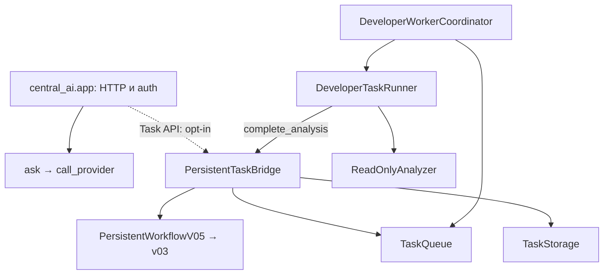

# Central AI / Market Engine — архитектура, решения и напредък

**Основен жив регистър. Обновен: 2026-11-04 (Europe/Sofia).** Датата в името е датата на създаване, а не последната актуализация. Cleanup checkpoint: ME-API-01, DUP-07, TEST-NUM-01, TEST-ENV-01, CI-COV-01 и OPS-02. Този документ е отправната точка за текущата работа; [планът P0–P4](PROJECT_FOCUS_AND_COMPLETION_GATES_2026-11-02.md) определя реда. Старите датирани одити са доказателства за своите снимки, а не текущ статус.

## 1. Кой код и коя среда описваме

| Източник | Проверен checkpoint | Какво доказва |
|---|---|---|
| GitHub `main` | `d987387f45dbe25940502ea25542e7ad99673359` | Основният клон все още не съдържа целия стек |
| Преглеждан изходен код | PR #129, `7fd9c850f73edea70988b017d8dda2a4b70f3fc3` | 293 commits напред спрямо посочения main; 187 променени файла. Това е снимката преди настоящата документационна промяна |
| CI на Central AI образа | PR #128, `c38f12b9f7b1d6d61ab469c90c9ce2af8068ac1b` | 33/33 workflow изпълнения са успешни; build checkout `4a50c6da38f554fd10080d6c14eacfb31a830882` |
| CI на baseline корекцията | PR #129, същият `7fd9c85…` | [Run 41725530297](https://github.com/nsavchev/central-ai-market-engine/actions/runs/41725530297), job `126385986276`: **7 passed**, 2026-11-04. Останалите 32 изпълнения на този стар SHA запазват failure статуса. Следващият documentation checkpoint `3555fa5cc3199230d12ae56461bce25b90f811a8`, със същия Python код, вече е 33/33 green; текущите поправки изискват собствено CI |
| Cleanup CI | PR #130, `b67b288f56d310a8bfea8ad16667b641039a377f` | **33/33 успешни workflows**, проверени при възстановяването на работата на 2026-11-04; включват PostgreSQL numeric boundaries |
| Test/CI поправка | PR #130, `cfdce9591ebf3e4668f42a28402119c25c4ecf02` | OPS-02 + 12 пропуснати test files; **33/33 CI successful** |
| VPS доказателства | Извън публичния source snapshot | Подробните оперативни записи не се възпроизвеждат тук; изискват отделен защитен преглед |
| Публичност | GitHub metadata: `visibility=public`, 2026-11-04 | Публично repository; не означава публично изложен VPS API |
| Пълен архитектурен/VPS одит | [Issue #90](https://github.com/nsavchev/central-ai-market-engine/issues/90) е OPEN | Част от доказателствата са събрани; остава reconciliation преди нов модул/активация |

Този преглед е върху публичния source и GitHub CI. Той не приписва source SHA на целия production release и не замества отделния преглед на защитените оперативни доказателства.

## 2. Обхват и собственост

Двата продукта са Central AI (управление на разрешени AI задачи) и Market Engine (данни, анализ и paper симулация). Developer Agent е компонент на Central AI, а не трети паралелен AI manager. Първо вътрешен paper simulator; IBKR paper — след проверката му. Реални поръчки не са част от обхвата.

| Отговорност | Съществуващ собственик | Реално състояние / граница |
|---|---|---|
| Автентикация, `/ask`, `/providers`, task HTTP интерфейс | `central_ai/app.py` | API кодът е наличен; task endpoints са opt-in. Provider adapters не доказват конфигурирани акаунти или успешни външни заявки |
| Начално планиране на задача | `TaskBridge.submit` → `developer_agent/v3/orchestrator.py` | Planning adapter; паметта му не е постоянният регистър |
| Атомарно подаване и записване на анализ | `PersistentTaskBridge.submit/complete_analysis` | Използва съществуващите storage, queue и workflow; не създаваме втори bridge |
| Постоянни task записи | `TaskStorage` в `central_ai/task_storage.py` | Един собственик на записите |
| Lease, heartbeat ownership и ограничени опити | `TaskQueue` + `HeartbeatWorker` | Една queue; не добавяме втори retry engine |
| Workflow преходи и възстановяване | `WorkflowController` v03 + `PersistentWorkflowV05` | v04 остава за съвместимост; старите модели не се изтриват без caller/recovery тестове |
| Избор на следваща задача | `DeveloperWorkerCoordinator.run_once` + `TaskFileTargets` | Координация, не генератор на код |
| Ограничен анализ на файл | `DeveloperTaskRunner.run_acquired_and_complete` → `ReadOnlyAnalyzer.analyze` | AST анализ без изпълнение на целевия Python файл; не е автономен repair loop |
| Подготовка на предложение и candidate | `prepare_review_pipeline`, `review_handoff`, `proposal_adapter`, `isolated_candidate`, `verifier_gate` | Opt-in pipeline с външно подадена препоръка; няма втора queue |
| Разрешена изолирана проверка | `prepare_and_verify` в `verified_review_pipeline.py` + `isolated_functional_verifier` | Отделни trusted tests и verify-only authorization; връща резултат, но не го записва като завършен постоянен repair lifecycle |
| Стар trusted verifier | `developer_agent/v3/trusted_verifier*/` | Различни pinned trust baselines; не се сливат само заради сходни имена |
| Обобщение за release | `stage2_release_gate.py`, `release_preflight.py`, `release_build_policy.py` | Проверка/доклад, не merge/deploy разрешение |
| Market HTTP / данни | `app/main.py`, `app/db.py`, `app/ibkr.py`, `app/engine.py` | Изходният код е наличен; текущият VPS Market API не е обновяван с този стек |
| Source permissions / SEC | `app/sources.py`, `sec_edgar.py`, `sec_financials.py`, `fundamentals*.py` | Client/normalization и части от persistence; безопасен автоматичен SEC импорт не е завършен |
| Relative strength, macro, valuation, quality | `engine.py`, `scanner.py`, `macro.py`, `valuation.py`, `advanced_valuation.py`, `data_quality.py` | Съществуващи алгоритми; някои offline/explicit-input. Не са доказани live feeds, автоматични два дневни отчета или backtested предимство |
| Paper ledger, fencing, replay | `paper_atomic_service.py`, `paper_pg_fence.py`, `paper_idempotency.py` | Изолирани тестове; производствената DB миграция не е извършена |
| DB проверки по фаза | `paper_migration_baseline.py`, `paper_legacy_column_contract.py`, `paper_schema_readiness.py`, `paper_schema_constraints.py`, `paper_data_preflight.py` | Различни отговорности; baseline eligible не означава пълна еквивалентност |
| Миграции | `alembic_stage2/`, `migrations/`, `paper_populated_migration.py` | Текущите Stage 2 пътища остават disposable-only за DB `test` |

## 3. Как се свързват компонентите

Следната схема показва зависимостите в прегледания код. Task клонът в repository Compose е **изключен по подразбиране**. Схемата не е runtime telemetry.

Отделният review път е `prepare_review_pipeline` (handoff → proposal → verifier gate → frozen candidate), след това изрично разрешено `prepare_and_verify`. Няма доказана автоматична връзка от HTTP заявка през provider-generated patch, независими тестове, постоянен запис на резултата и ограничени повторни поправки до финален human review. Това е оставащата P1 работа, а не основание за нов AI manager.

Market Engine използва своя FastAPI app и PostgreSQL. Вътрешните paper операции са отделени от Central AI task SQLite. Source registry е контрол на достъпа до източници, а не разрешение за scraping. Следва да се запазят тези граници.

Пълните статични дефиниции, import връзки, blob SHA за модулите и dependency snapshot на отворените PR-и са в [генерираната инвентаризация](project-architecture-inventory.json). Съществуващият инструмент е `tools/audit_python_ownership.py`; не е добавян нов scanner. AST imports не са runtime call graph и не разрешават dynamic dispatch.

## 4. Граница между публичен source и оперативни доказателства

Този регистър публикува code ownership, API/function зависимости, публични Git commit/PR/CI връзки и acceptance условия. Подробни VPS конфигурации, deployment/database/image/volume метаданни, private backup сведения, ключове и техните runtime стойности не са част от настоящата публична промяна.

Source Compose описва opt-in tasks и отделни Central AI/Market API/DB отговорности. Това е конфигурационна политика от repository, не доказателство за текуща production конфигурация. Нито green CI, нито metadata от GitHub доказват сами по себе си runtime deployment или успешна provider връзка.

Операторските проверки са отделен evidence поток под #90. Публичният запис може да отбелязва, че доказателство е предоставено или че остава критерий, без да копира защитените оперативни данни. Този documentation checkpoint не изпълнява production операции и не затваря целия runtime/security одит.

## 5. Зависимости на PR-ите

При source snapshot-а има **127 отворени PR-а**; това е броят преди настоящия documentation PR. Те не са 127 независими продукта. Машинният регистър съдържа всеки number, base/head branch и SHA. Git history е точният регистър на комитите; таблицата по-долу е управленското обобщение, а не измислена ретроспекция на всяка редакция.

| PR | Base → head | Предназначение | Статус на checkpoint-а |
|---|---|---|---|
| #126 | AI-26 → `df4a20f…` | AI-27 интеграционни pass/fail сценарии; injected verifier | Draft, unmerged; не доказва автономно поправяне |
| #127 | #126 → `b53a115…` | Замразен обхват и P0–P4 | Draft, unmerged |
| #128 | #127 → `c38f12b…` | P0 release/security и възпроизводим образ | Draft, unmerged; 33/33 CI; API-only образът е отделно прехвърлен |
| #129 | #128 → `7fd9c85…` | READ ONLY baseline и VPS DDL fixture | Draft, unmerged; 7 baseline теста passed, останалите CI още не са повторени |
| #130 — стабилизиране | #129 → `3555fa5…` → текущ cleanup candidate | Регистър, ME-API-01, DUP-07 и test coverage | Draft/unmerged; cleanup `b67b288…` е 33/33 green; OPS-02 / CI-COV-01 source `cfdce959…` — **33/33 CI successful** |

Не merge-ваме стека наведнъж и не пренасяме source от `main` върху VPS с blind pull/compose build. Първо се проверяват ancestry, дифовете, точният candidate и #90.

## 6. Регистър на дублиране и конкретни дефекти

[Подробна матрица DUP-01–07](AUD01_DUPLICATION_TRIAGE_AND_REFACTOR_GATES.md). В статичния snapshot има **89 модула** (34 app, 29 central_ai, 26 developer_agent), **275 function/class дефиниции**, **72 записани локални import връзки**, **16 групи с еднакви имена**, **0 parse failures**. Тези числа не са процент на готовност. Tests/migrations/tools са извън трите root-а; общо в tree има 168 Python файла.

- DUP-01: workflow модели — canonical v03 + persistent v05; caller/state compatibility преди консолидация.
- DUP-02: v04/v05 — legacy restore съвместимост, не автоматично изтриване.
- DUP-03: verifier поколения — pinned trust boundaries, не взаимозаменяеми по име.
- DUP-04: TaskBridge registry срещу TaskStorage — transient planning adapter срещу durable owner.
- DUP-05: schema preflights — различни фази, съставяне на отчет вместо изтриване.
- DUP-06: CI workflows — бъдеща консолидация само със запазени required checks/coverage.
- DUP-07: премахнати недостижимите parser/success branches и неизползваните imports/constants след `UNVERIFIED_REPORT_BLOCKED`. Същата функция и CLI остават безусловно блокирани; тестове проверяват отказ без четене и nonzero CLI exit дори за success-looking JSON.
- **ME-API-01 / HIGH — поправен в cleanup candidate:** различни import aliases `analyze_market` и `analyze_valuation` в `app/main.py` запазват алгоритмите в техните owners. Новите реални ASGI HTTP regression проверки възпроизведоха два HTTP 500 преди промяната; след нея проверяват relative strength, advanced DCF, 422 за липсващи общи сесии, 409 при нееднозначен symbol и 401 без token.
- **TEST-NUM-01 — поправено погрешно тестово очакване:** `NUMERIC(20,2)` допуска 18 integer + 2 fractional digits. Валидаторът `_fits` не е променян; тестът вече приема точните положителна/отрицателна граници и отхвърля реален overflow. Четири проверки срещу PostgreSQL CAST са добавени в съществуващия CI workflow.
- **TEST-ENV-01 — явни локални prerequisites:** пет PostgreSQL тестови модула пропускат теста само при липсващ URL в локална среда. CI продължава да изисква test URL; останалите DB-name/host проверки са запазени.
- **DUP review:** source scan на трите roots след поправката намери 0 conflicting top-level imports и 0 function-body tails след безусловни return/raise. Две групи с идентични top-level AST тела са verifier CLI wrappers с различни pinned owners/baselines; това не е основание да се изтрие trust boundary. Legacy persistence и task storage/lease слоевете също не са обявени за семантични дубликати.

## 7. Текущ работен регистър

| ID | Собственик / цел | Статус | Оставащо условие / следващо действие |
|---|---|---|---|
| DOC-01 | Този регистър + focus plan | Обновен в настоящата промяна | Поддържа се при всяка следваща задача и handoff |
| AUD-01 | Ownership/import инвентаризация | Статичен snapshot готов; runtime reconciliation PARTIAL | Ключовите callable bindings, compatibility callers и действителните deployed imports остават за проверка |
| AUD-02 | PR зависимости/main drift | 127 PR-а инвентаризирани; review PARTIAL | Класификация на страничните линии и интеграционен diff, без bulk merge |
| P0-CI | Проверки на точния source | #130 `b67b288…`: 33/33 green; `cfdce959…`: **33/33 CI successful** | DONE за точния test/CI source; следва P0-RECON; старите #129 failures остават исторически |
| SEC-01 | Secrets/publication | GitHub metadata потвърждава public | Публичността не доказва пълен security audit; подробни оперативни данни не се публикуват |
| OPS-API | Central AI API-only | Отделен операторски evidence поток | Публичният source регистър не разширява разрешенията към worker/task активация |
| DB-01 | Production schema | Evidence reconciliation PARTIAL | Пълни constraints/indexes/defaults/sequences/ownership/ACLs и всички writers |
| DB-02 | Backup/restore | Отделен защитен операторски запис | Повторни реалистични rehearsal-и и roles/ACL recovery преди миграция |
| DB-03 | Production baseline/migration | BLOCKED | DB-01/02, отделен reviewed production runbook, два restored-copy rehearsal-а и explicit authorization; не премахваме disposable guards |
| AI-01 / AI-02 | Един developer loop | Компоненти и отделни CI проверки; PARTIAL | Независим test/authorization източник, постоянен post-test резултат, bounded repair/restart/cancel и безопасен runner |
| ME-API-01 / DUP-07 | Route binding и blocked legacy CLI | DONE за source `b67b288…`: 33/33 CI | Без нов runtime модул; runtime deployment остава отделна проверка |
| TEST-NUM-01 / TEST-ENV-01 | Числови граници и test prerequisites | DONE за source `b67b288…`: 33/33 CI, включително PostgreSQL | Локалните PostgreSQL skips не се отчитат като passed |
| CI-COV-01 | Изпълнение на всички съществуващи test files | 12 липсващи файла добавени към 5 съществуващи workflow команди в `cfdce959…` | Няма нерефериран `tests/test_*.py` файл; **33/33 CI successful** |
| DATA-01 | SEC безопасен автоматичен импорт | PARTIAL | `validate_source`, permissions, Financials provenance и quality преди PostgreSQL write |
| DATA-02 / MODEL-01 | Relative strength, macro, 3 сценария | PARTIAL | Проверени данни/fixtures, assumptions и два дневни отчета |
| OPS-PAPER | Вътрешен paper simulator, после IBKR paper | Изолирано покритие; production integration BLOCKED | DB/runbook/consumer acceptance, без реални поръчки |
| OPS-02 | Starlette/TestClient warning | DONE за `cfdce959…`; **33/33 CI successful** | `requirements-test.txt`: httpx2; тесен error warning policy в `pytest.ini`; runtime httpx и release lock са запазени |

**Единствена следваща активна задача:** P0-RECON — съпоставяне на PR stack/main drift и ownership с останалите защитени VPS доказателства по #90. P0-CI и OPS-02 са затворени за source `cfdce9591ebf3e4668f42a28402119c25c4ecf02` (**33/33 успешни workflows**). Blocker: пълен runtime/import/writer/roles/ACL reconciliation липсва; acceptance е evidence map с проверени gaps и конкретно bounded P1 действие. Това не затваря целия P0 или #90. P1 Central AI остава преди новите P2 Market Engine функции; настоящият API дефект е стабилизиране на съществуваща функционалност.

## 8. Решения и история на checkpoint-ите

| Дата | ID / промяна | Решение и доказателство | Резултат / оставащо |
|---|---|---|---|
| 2026-10-26 | AUD-01/02 | Създаден ownership/progress регистър; queue/bridge/coordinator/runner са различни слоеве | Запазваме собствениците; старият snapshot се пази в Git history |
| 2026-11-02 | SCOPE / PR #127 | Два продукта, P0–P4, без безкрайни AI-XX wrappers | Обхватът остава замразен |
| 2026-11-03 | P0 / PR #128 | Immutable source/image/lock и verify-only граници; 33/33 CI | Образът не разрешава developer-loop activation |
| 2026-11-03 | OPS-API / DB-01/02 | Оперативните evidence потоци са отделени от GitHub source/CI | Подробните deployment/database/backup сведения остават извън тази публична промяна |
| 2026-11-03 | DB-BASELINE / PR #129 | `inspect_legacy_baseline` enforcing READ ONLY/REPEATABLE READ; fixture + 4 PG regression сценария | CI първоначално не стартира заради изчерпания included Actions лимит |
| 2026-11-04 | SEC-01 / PUBLIC | Операторът промени repo към public; GitHub metadata потвърди | Публичността на repository не е разрешение за production промени |
| 2026-11-04 | P0-CI baseline retry | Run 41725530297, job 126385986276: 7 passed | Другите 32 проверки още предстоят |
| 2026-11-04 | DOC-01 / AUD-01 | Преизползван AST scanner: 89 модула/275 дефиниции; обновени съществуващите основни документи, README и contributor инструкции; добавен един JSON snapshot | Без нов Python модул, queue, scheduler, verifier, CI workflow или VPS промяна |
| 2026-11-04 | ME-API-01 / DUP-07 | След изричната cleanup задача PR #130 е разширен с отделен code commit; два aliases и премахнати недостижими report branches | Целеви набор 25 passed; новите HTTP тестове възпроизведоха 2 failures преди поправката |
| 2026-11-04 | TEST-NUM-01 / TEST-ENV-01 | Поправено погрешно numeric boundary очакване; локалните DB prerequisites са явни и CI остава задължителен | Aggregate local run: **295 passed, 43 skipped, 1 warning**; skipped PostgreSQL тестовете не са отчетени като passed |
| 2026-11-04 | CI-COV-01 | Новите route/numeric regressions са включени в два съществуващи workflow-а | Без нов Python runtime модул или нов CI workflow; Starlette warning остава OPS-02 |

| 2026-11-04 | HANDOFF / P0-CI | Възстановен контекст от прекъсналия чат и сверени GitHub файлове; `b67b288…` има 33/33 successful workflows | Предишното съобщение за 12 добавени test files не се потвърждава от този source; добавени са в `cfdce959…`, без ретроактивно приписване |
| 2026-11-04 | OPS-02 / CI-COV-01 | Owner: Starlette TestClient dependency resolution и съществуващите CI команди. Файлове: `requirements-test.txt`, `pytest.ini`, 26 workflow dependency lines, 5 test lists и README. PR #130 base: `7fd9c850f73edea70988b017d8dda2a4b70f3fc3`; source: `cfdce9591ebf3e4668f42a28402119c25c4ecf02` | Python 3.12: **300 passed, 43 skipped, 0 warnings**; `pip check` OK; negative missing-httpx2 import отхвърлен от warning policy; TestClient действително използва httpx2 2.16.0; runtime httpx 0.28.1 е запазен; **33/33 CI successful** |

Това е обобщение на проверимите checkpoint-и. То не твърди, че всяка стара промяна е била навреме описана отделно; точният пълен diff/история остава в Git и PR-ите.

## 9. Правило за всяка следваща промяна

1. Прочети този регистър, focus plan и съответния owner/caller/test код; използвай `rg` и съществуващия inventory tool.
2. Запиши TASK_ID, първоначална цел, съществуващ собственик/функции, защо е нужно изменение, файлове, dependencies и измеримо acceptance условие.
3. Предпочитай корекция на съществуващия собственик. Нов module/queue/controller/verifier изисква конкретен доказан пропуск и записано ownership решение.
4. След промяната запиши PR/base/head/source SHA, точните проверки и резултати, отделно GitHub/CI, операторски VPS evidence и непроверено. Update-вай този жив документ, не създавай нов датиран „основен“ регистър.
5. При всяко предаване на работата остави една следваща активна задача, blocker и acceptance условие. Отложените изисквания остават в таблицата.
6. Snapshot JSON се обновява при source/PR-inventory преглед, с точния анализиран commit. Не го наричай live runtime telemetry.
7. `approved=False`, `deployment_allowed=False`, no automatic merge/deploy, task API NO и paper-only остават граници. Green CI или наличен API ключ не ги отменя. Production промени изискват конкретно разрешен обхват.

## 10. OPS-02 възстановяване и проверка

[Официалният TestClient документ](https://starlette.dev/testclient/) описва httpx2 като предпочитан client. Възпроизведеното предупреждение идва от import fallback към httpx при липсващ httpx2. Добавен е тестов requirements файл, който включва съществуващия runtime requirements и httpx2 `>=2,<3`. 26 съществуващи CI test jobs използват този файл; няма нов workflow. `pytest.ini` превръща само конкретното fallback предупреждение в грешка. Няма warning suppression, runtime provider migration или промяна на pinned release образа.

CI-COV-01 mapping: `test_central_ai.py` → DUP-01; седем offline/data/valuation набора → Stage 1 real HTTP; executed_at contract → atomic idempotency; empty-fence contract → disposable migration; schema constraints/readiness → realistic schema. Всички съществуващи `tests/test_*.py` файлове вече са реферирани в CI командите; това не доказва всеки runtime път.

Локален aggregate: активиран изолиран venv, `python -m pytest -q`, **300 passed / 43 skipped / 0 warnings**. Skips са PostgreSQL prerequisites. `pip check`, AST parsing (275 definitions), warning negative check и CI file-reference check са успешни. GitHub/CI на точния source `cfdce9591ebf3e4668f42a28402119c25c4ecf02`: **33/33 success**. Примери: [Central AI contracts + API](https://github.com/nsavchev/central-ai-market-engine/actions/runs/41784611695), [Market HTTP + offline/data regressions](https://github.com/nsavchev/central-ai-market-engine/actions/runs/41784611969), [locked image](https://github.com/nsavchev/central-ai-market-engine/actions/runs/41784612036). Настоящата последваща промяна обновява само документацията; VPS не е проверяван или променян в тази сесия.
